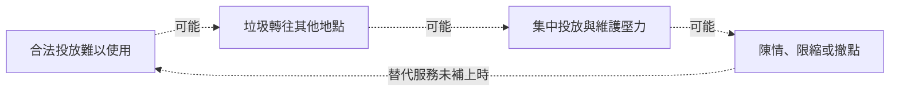

# 從投放到清運：台北垃圾回饋的完整分析

分析整理日：2026-10-17（非收集日期）

這份資料是台北市意見回饋中篩出的垃圾相關訊息。分析單位是一則留言；比例只描述這批留言，不代表全體意見回饋或台北市民意。

方法修正：原先的關鍵字命中統計已退出本頁問題分析。先前據此解釋北投、內湖、萬華問題的段落已撤回；以下數字只由逐則語意標註加總。

## 各區留言主題占比：十二區 × 七類問題

分母是該行政區標記在本檔的全部留言，包含資訊不足與其他內容。一則可談多個問題，比例不能相加；顏色表示留言組成，不是問題嚴重程度、人口發生率或缺桶程度。行政區尚未確認為事件所在地或居住地，事件日期也未核實。

比較表每格以區內占比呈現，網頁色階全表固定為 0–100%，不按區或主題各自縮放。各區判讀與改善方向接在比較表下方。

| 行政區（則數） | 桶位與投放便利 | 家戶收運與投放管道 | 清掃、清運與設備維護 | 亂丟、混投與垃圾來源 | 分類、回收與廚餘處理 | 異味、鼠蟲與鄰近負擔 | 制度、執法與管理回應 |
| --- | ---: | ---: | ---: | ---: | ---: | ---: | ---: |
| 松山（233） | 169（72.5%） | 17（7.3%） | 62（26.6%） | 51（21.9%） | 13（5.6%） | 33（14.2%） | 43（18.5%） |
| 信義（216） | 145（67.1%） | 18（8.3%） | 67（31.0%） | 37（17.1%） | 12（5.6%） | 24（11.1%） | 53（24.5%） |
| 大安（492） | 368（74.8%） | 47（9.6%） | 132（26.8%） | 107（21.7%） | 23（4.7%） | 62（12.6%） | 120（24.4%） |
| 中山（354） | 249（70.3%） | 21（5.9%） | 107（30.2%） | 76（21.5%） | 17（4.8%） | 54（15.3%） | 102（28.8%） |
| 中正（211） | 127（60.2%） | 24（11.4%） | 59（28.0%） | 43（20.4%） | 21（10.0%） | 24（11.4%） | 47（22.3%） |
| 大同（195） | 143（73.3%） | 14（7.2%） | 52（26.7%） | 47（24.1%） | 14（7.2%） | 29（14.9%） | 45（23.1%） |
| 萬華（241） | 106（44.0%） | 28（11.6%） | 110（45.6%） | 67（27.8%） | 21（8.7%） | 48（19.9%） | 73（30.3%） |
| 文山（135） | 73（54.1%） | 25（18.5%） | 33（24.4%） | 31（23.0%） | 13（9.6%） | 16（11.9%） | 30（22.2%） |
| 南港（82） | 53（64.6%） | 9（11.0%） | 18（22.0%） | 23（28.0%） | 6（7.3%） | 9（11.0%） | 23（28.0%） |
| 內湖（155） | 104（67.1%） | 14（9.0%） | 44（28.4%） | 40（25.8%） | 20（12.9%） | 19（12.3%） | 50（32.3%） |
| 士林（210） | 126（60.0%） | 26（12.4%） | 57（27.1%） | 57（27.1%） | 20（9.5%） | 31（14.8%） | 74（35.2%） |
| 北投（139） | 74（53.2%） | 22（15.8%） | 26（18.7%） | 34（24.5%） | 23（16.5%） | 8（5.8%） | 53（38.1%） |

### 十二區問題與改善方向

常談議題取區內則數最多的兩類，同數並列；相對差異取本區與其餘各區合併留言的最大正向比例差。兩者回答不同問題。差異是探索性描述，未做顯著性檢定。細條統一以 0–100% 顯示區內比例；一則可跨類，比例不能相加。

合併判讀同時讀取公開位置列與語意結果，屬於待驗證的研究解釋，不是缺桶診斷或設點優先序。

現有資料較支持分區查核方向，還不能確認哪區實際缺桶。松山、大安、大同較偏投放可達性；萬華先查清掃與維護；文山要另外處理家戶收運。信義、中山、中正、內湖、士林有混合問題；北投與南港先核實清冊及場域可用條件，再分清配置、清運或管理。

[完整位置與回饋對照及來源](../feedback-distribution-2026-10-18/README.md)

| 行政區（本檔則數） | 街頭位置列／場域紀錄筆數（不相加） | 區內常談議題 | 相對差異（本區 vs 其餘各區） | 合併判讀 · 待驗證 |
| --- | ---: | --- | --- | --- |
| 松山（233） | 55／7 | 桶位與投放便利 169／233（72.5%）；清掃、清運與設備維護 62／233（26.6%） | 桶位與投放便利：169／233（72.5%）vs 1568／2430（64.5%），+8.0 百分點 | 較偏投放可達性：找桶、恢復或保留桶的訴求較突出。場域清單增加可查的場所，仍不能證明日常路徑有可用的投放點。 下一步：沿步行與轉乘路徑核對可見性、開放及接收條件，同點記錄滿溢與清掃。 分辨依據：路徑缺少投放點才考慮配置；找到桶卻常滿，先查巡收與垃圾來源。 |
| 信義（216） | 60／18 | 桶位與投放便利 145／216（67.1%）；清掃、清運與設備維護 67／216（31.0%） | 清掃、清運與設備維護：67／216（31.0%）vs 700／2447（28.6%），+2.4 百分點 | 投放為主，清掃維護一起查：投放便利線索最多，清掃維護與管理回應也常出現。商場或站點被列入清單，不代表能隨時接收沿途垃圾。 下一步：同一路徑核對街頭及場域的開放、接收、找桶距離，另記桶況與清掃巡收。 分辨依據：找不到可用點再查配置；已有可達的桶卻滿溢，先查負荷與巡收。 |
| 大安（492） | 47／18 | 桶位與投放便利 368／492（74.8%）；清掃、清運與設備維護 132／492（26.8%） | 桶位與投放便利：368／492（74.8%）vs 1369／2171（63.1%），+11.7 百分點 | 較偏投放可達性：找桶及增設、恢復或保留的方向較突出。街頭位置與場域紀錄提供查核起點，不能當成完整服務範圍。 下一步：沿日常步行路徑核實可用點、開放時段與指引，同時記錄滿溢或阻塞。 分辨依據：位置遠與入口不清要分開；已找到卻不能投放，轉查維護或接收條件。 |
| 中山（354） | 50／16 | 桶位與投放便利 249／354（70.3%）；清掃、清運與設備維護 107／354（30.2%） | 桶位與投放便利：249／354（70.3%）vs 1488／2309（64.4%），+5.9 百分點 | 投放為主，維護與管理並查：投放便利線索較多，也有滿溢、巷弄清掃與陳情回應問題。街頭與場域紀錄無法分清哪個環節失效。 下一步：同一路徑記錄投放成敗、桶況、巡收及陳情處理，另記一般街面清掃。 分辨依據：找不到、找到卻不能投、街面未清，應分別查配置、維護和清掃責任。 |
| 中正（211） | 83／16 | 桶位與投放便利 127／211（60.2%）；清掃、清運與設備維護 59／211（28.0%） | 分類、回收與廚餘處理：21／211（10.0%）vs 182／2452（7.4%），+2.5 百分點 | 投放、家戶服務與分類分開查：投放便利線索最多，也有清掃、家戶收運及分類接收問題；街頭與場域清單無法回答各類垃圾的去處。 下一步：分行人小垃圾、家戶垃圾與回收，核對各自合法去處、時段及接收規則。 分辨依據：行人路徑缺少投放點才查桶位；趕不上車或被拒收，分別查家戶服務與接收規則。 |
| 大同（195） | 22／14 | 桶位與投放便利 143／195（73.3%）；清掃、清運與設備維護 52／195（26.7%） | 桶位與投放便利：143／195（73.3%）vs 1594／2468（64.6%），+8.7 百分點 | 較偏投放可達性：投放與增設、恢復或保留訴求較突出；場域紀錄仍須核實能否進入、投放，不能抵銷街頭路段的疑問。 下一步：補核列管清冊，再沿實際步行路徑查位置、開放與可用性，同時記錄清潔。 分辨依據：沒有順路可用點才支持配置缺口；有點但未開放或滿溢，應查服務條件。 |
| 萬華（241） | 82／3 | 清掃、清運與設備維護 110／241（45.6%）；桶位與投放便利 106／241（44.0%） | 清掃、清運與設備維護：110／241（45.6%）vs 657／2422（27.1%），+18.5 百分點 | 清掃維護線索較強，投放仍要查：清掃維護 110 則，與投放便利 106 則接近；管理回應也有線索。不能據此說桶已足夠，或整區只需加強清運。 下一步：分開記錄桶旁滿溢、一般街面清掃、垃圾來源與巡收，並核實可用投放路徑。 分辨依據：有桶反覆滿溢才追清運與負荷；空桶旁仍髒亂要查來源，路徑缺少投放點另查配置。 |
| 文山（135） | 51／9 | 桶位與投放便利 73／135（54.1%）；清掃、清運與設備維護 33／135（24.4%） | 家戶收運與投放管道：25／135（18.5%）vs 240／2528（9.5%），+9.0 百分點 | 投放之外，家戶收運另成一題：投放便利仍是最多的主題；家戶收運 25／135 則，占比在本檔各區最高。場域紀錄不能直接當成家戶代收點。 下一步：行人路徑查可用點；家戶另核對作息、垃圾車時間與合法替代管道。 分辨依據：錯過垃圾車應比較時段或代收服務，不能轉成街頭增桶需求。 |
| 南港（82） | 4／5 | 桶位與投放便利 53／82（64.6%）；亂丟、混投與垃圾來源 23／82（28.0%）；制度、執法與管理回應 23／82（28.0%） | 亂丟、混投與垃圾來源：23／82（28.0%）vs 590／2581（22.9%），+5.2 百分點 | 先查投放路徑與場域可用性：街頭四列集中經貿周邊，另五筆場域紀錄不能代表全區服務；留言兼有投放、滿溢、混投與管理情境。 下一步：補核區內清冊，查街頭與場域的步行銜接、開放、接收條件及桶況。 分辨依據：無合法順路去處才支持配置缺口；有桶常滿或混投，轉查巡收和垃圾來源。 |
| 內湖（155） | 85／7 | 桶位與投放便利 104／155（67.1%）；制度、執法與管理回應 50／155（32.3%） | 制度、執法與管理回應：50／155（32.3%）vs 663／2508（26.4%），+5.8 百分點 | 配置與接收規則、管理並查：投放便利是主要線索；另有滿桶、分類資訊不清與反對增設的意見，不能只用桶位多寡解釋。 下一步：沿路記錄找桶與投放成敗，核對場域時段、分類指引、接收規則及巡收。 分辨依據：有桶卻滿溢先查清運；規則不一先查接收與資訊；路徑缺少投放點再比較配置。 |
| 士林（210） | 142／7 | 桶位與投放便利 126／210（60.0%）；制度、執法與管理回應 74／210（35.2%） | 制度、執法與管理回應：74／210（35.2%）vs 639／2453（26.0%），+9.2 百分點 | 投放配置與清掃、管理並查：街頭列數在本檔最多，投放訴求仍常出現；巷弄清掃與管理回應也有線索，列數多不等於服務完整。 下一步：沿活動路徑查可達與可用性，對照桶旁巡收、巷弄清掃和陳情紀錄。 分辨依據：缺少順路投放點與街面未清是不同問題；不能以清冊列數排除任一種。 |
| 北投（139） | 0／10 | 桶位與投放便利 74／139（53.2%）；制度、執法與管理回應 53／139（38.1%） | 制度、執法與管理回應：53／139（38.1%）vs 660／2524（26.1%），+12.0 百分點 | 投放與管理有線索，清冊先核實：街頭主檔零列，另十筆場域紀錄；不能判為零設施或全區撤除。投放、管理與家戶收運仍須分開查。 下一步：核對有日期的現存與撤除清冊，再查場域開放、接收及路徑；家戶服務另查。 分辨依據：先確認哪些服務仍存在；可進入卻不接收，屬服務條件問題，不能由零列判缺桶。 |

### 相對差異的計算與判讀限制


#### 逐區閱讀差異

為方便逐區閱讀，下表列出每區相對「其餘各區合併留言」比例差最大的正向對照；依未四捨五入的百分點差選取，同差時按分類順序。這是探索性摘要，並非顯著性檢定或改善優先序。完整交叉表保留其他類別，不能只憑這一格替整區貼標籤。

| 行政區／對照類別 | 本區則數／分母（比例） | 其餘各區則數／分母（比例） | 差值（百分點） |
| --- | ---: | ---: | ---: |
| 松山／桶位與投放便利 | 169／233（72.5%） | 1568／2430（64.5%） | +8.0 |
| 信義／清掃、清運與設備維護 | 67／216（31.0%） | 700／2447（28.6%） | +2.4 |
| 大安／桶位與投放便利 | 368／492（74.8%） | 1369／2171（63.1%） | +11.7 |
| 中山／桶位與投放便利 | 249／354（70.3%） | 1488／2309（64.4%） | +5.9 |
| 中正／分類、回收與廚餘處理 | 21／211（10.0%） | 182／2452（7.4%） | +2.5 |
| 大同／桶位與投放便利 | 143／195（73.3%） | 1594／2468（64.6%） | +8.7 |
| 萬華／清掃、清運與設備維護 | 110／241（45.6%） | 657／2422（27.1%） | +18.5 |
| 文山／家戶收運與投放管道 | 25／135（18.5%） | 240／2528（9.5%） | +9.0 |
| 南港／亂丟、混投與垃圾來源 | 23／82（28.0%） | 590／2581（22.9%） | +5.2 |
| 內湖／制度、執法與管理回應 | 50／155（32.3%） | 663／2508（26.4%） | +5.8 |
| 士林／制度、執法與管理回應 | 74／210（35.2%） | 639／2453（26.0%） | +9.2 |
| 北投／制度、執法與管理回應 | 53／139（38.1%） | 660／2524（26.1%） | +12.0 |

各區「判讀不明確／無法歸入七類」則數（兩者可重疊，均保留在分母）：松山 3／1、信義 6／1、大安 17／0、中山 8／1、中正 7／1、大同 4／1、萬華 11／0、文山 7／2、南港 2／1、內湖 10／3、士林 7／0、北投 5／0。

下一步先依具體情境核對時間、地點、垃圾來源與服務條件，再安排可比的現場觀察。語意比例可以幫助選取訪談題目；仍需補齊各區招募、完整回饋數與篩選方式，才能評估資料收集造成的差異。

## 投放方便與環境負擔，需要一起判斷

各區有共通問題，也有不同的回饋組合。全檔最常談及的是「桶位與投放便利」，共 1,737 則（65.2%），在 12 個區的留言中都有出現。同一主題包含困擾、改善訴求或風險顧慮；問題類別相同，不代表支持同一措施。

為分清家戶服務與現場維護，以下各取一個區內比例最高的例子：「家戶收運與投放管道」在文山標記留言中的比例最高，為 25／135（18.5%），其餘各區合併為 240／2528（9.5%）；「清掃、清運與設備維護」在萬華標記留言中的比例最高，為 110／241（45.6%），其餘各區合併為 657／2422（27.1%）。這是從本檔選出的描述性對照，不代表當地實際最嚴重，也不能替整區只指定一種問題。

這批回饋提示了三種需要分開查核的困擾：外出時找不到可用的投放處、家戶作息難以配合收運，以及投放點周邊的滿溢與清潔負擔。我們的研究判斷是，先把投放到清運的完整過程看清楚，再決定要調整位置、時段、接收規則或維護。

希望增加或恢復垃圾桶，與反對住宅附近設桶，可以同時出現在這份資料中。前者可能關注沿途的方便，後者可能承擔堆積、異味與清掃負擔。因此，改善是否有用，需要同時看「使用者能否完成投放」與「周邊負擔是否減少」，也要查看問題有沒有轉往鄰近地點。

本文先區分三種情境，再追問原因與反例，最後把假說收斂成可執行的查核順序。本次已逐則做 AI 語意判讀，並分開統計問題與設桶立場；現場尚未核實，像「撤桶導致髒亂」這樣的描述，仍需核對時間順序與其他變化。

## 逐則語意判讀：談及的問題與訴求

三個子代理逐則閱讀檔案內文字，依實際意思標註問題、訴求與公共桶立場，不使用關鍵字規則分類。每則可涉及多個問題，同類最多計一次；比例不能相加。原文中的否定、條件與服務情境需要分開理解。AI 判讀仍可能有誤，現場與因果均未驗證。

| 欄位值 | 則數 | 占本檔比例 |
| --- | ---: | ---: |
| 桶位與投放便利 | 1,737 | 65.2% |
| 家戶收運與投放管道 | 265 | 10.0% |
| 清掃、清運與設備維護 | 767 | 28.8% |
| 亂丟、混投與垃圾來源 | 613 | 23.0% |
| 分類、回收與廚餘處理 | 203 | 7.6% |
| 異味、鼠蟲與鄰近負擔 | 357 | 13.4% |
| 制度、執法與管理回應 | 713 | 26.8% |

- **桶位與投放便利：**桶的數量、撤除、位置、距離、入口與使用便利；家戶收運站另歸家戶服務。
- **家戶收運與投放管道：**垃圾車時間、路線、等待、作息衝突、定點或社區代收；僅描述家戶混投不算此類。
- **清掃、清運與設備維護：**滿溢、清掃或清運不足、設備損壞、髒亂未處理；不因提到桶或亂丟就自動納入。
- **亂丟、混投與垃圾來源：**亂丟、非法棄置、家戶或商業垃圾混投、菸蒂狗便等來源行為；明示的風險仍是訴求而非核實事件。
- **分類、回收與廚餘處理：**分類與接收規則、拒收、指引差異、回收或廚餘處理；只提物品名稱不算。
- **異味、鼠蟲與鄰近負擔：**明示的臭味、鼠蟲、收運噪音、阻礙通行或鄰近負擔；不從髒亂自行推定鼠蟲。
- **制度、執法與管理回應：**費率與袋規則、執法、責任、政策溝通、陳情回應與治理公平；一般增桶請求不自動納入。

判讀不明確 87 則；無法歸入七類 11 則。兩者可能重疊，全部保留在分母，沒有強迫分類。

## 提到垃圾桶，不等於支持增設

以下僅判讀公共／街道垃圾桶的方向；家戶定點收運不自動算成增設公共桶。每則恰有一個立場標籤，分母仍為全檔留言，不是市民支持率。

| 欄位值 | 則數 | 占本檔比例 |
| --- | ---: | ---: |
| 偏向增設／恢復／保留 | 1,456 | 54.7% |
| 偏向減少／撤除／反對設置 | 29 | 1.1% |
| 有條件增設或保留 | 9 | 0.3% |
| 方向混合或明示權衡 | 16 | 0.6% |
| 談到公共桶但方向不明 | 330 | 12.4% |
| 未表達公共桶立場／以其他議題為主 | 823 | 30.9% |

## 先辨認三種服務情境

行人投放與家戶收運是兩種不同使用情境；現場維護則決定投放點能否持續可用。下面把留言線索整理成查核問題，箭頭表示查核順序，不是人數分群或因果證明。

| 留言情境 | 先分辨 | 要補的證據 |
| --- | --- | --- |
| 行人投放：走路、轉乘、遊逛時找不到可用的桶 | 位置、辨識與實際可用性 | 沿真實路徑記錄找桶時間、繞路及投放成敗 |
| 家戶收運：上班、輪班或照顧安排難配合垃圾車 | 收運時段與替代管道 | 核對可到達的合法去處、開放時間與使用條件 |
| 現場維護：桶旁垃圾、滿溢、鼠蟲或異味的困擾 | 負荷、巡收與鄰里負擔 | 同點重複記錄桶況、清運時間與周邊垃圾 |

分開情境，是為了確認服務在哪一段難以使用。接下來要追問：路徑太遠、時段不合，還是到了現場仍不能投放？同樣的「不好丟」，可能需要不同的改善。

## 從情境追問原因與反例

前述統計描述留言中的問題與訴求；以下將情境串成可查核的假說，保留其他解釋與反例。類別的留言數不等於受影響人數或發生率，機制仍待現場驗證。

### 三個主要問題：位置、時段與維護

先沿著使用情境查核服務是否可用，逐一區分會導向不同措施的原因。

#### 找不到桶，先分辨位置、辨識與可用性

**留言線索：**留言有人希望增加或恢復投放點，也有人反對住家附近設桶。便利與鄰近負擔是兩個要同時觀察的結果。

**可能機制 · 待驗證：**可能是路徑上距離遠、看不見入口，或到了現場卻滿溢、阻塞；三者需要不同的改善方式。

**其他解釋與反例：**也有人會把垃圾帶回家，不能畫成「無桶必然亂丟」。「找不到」也可能是配置或資訊問題；若桶已順路且可用，增設未必能處理清潔問題。

**如何查核：**沿相同出發點與目的地記錄路徑、找桶秒數、繞行距離、辨識情形、投放成功與失敗原因；記下時間與現場條件。

**結果如何改變決定：**距離與繞路主導時才比較配置；接近後仍找不到入口，先比較指引；已找到卻不能投放，轉查維護。

#### 家戶收運的限制可能出在時間

**留言線索：**留言有人描述下班、輪班或照顧安排與垃圾車時間衝突，也出現希望有固定或彈性投放管道的想法。

**可能機制 · 待驗證：**即使地理上離收運點很近，開放時間與可出門時間沒有交集，服務仍可能難以使用。

**其他解釋與反例：**也有定點太遠、開放時間變動造成空跑，以及深夜垃圾車噪音的回饋。延後時段可能增加附近負擔，不能把所有家戶混投都歸因於追不到車。

**如何查核：**以自願訪談核對可投放時段、實際服務時間、步行可達性、使用條件及既有替代方式；不保存可識別個人的作息。

**結果如何改變決定：**先找出哪一段時間或條件無法使用，再比較調班、既有代收或其他替代服務；不能由留言推定接受付費。

#### 滿溢要追到負荷與巡收的時間差

**留言線索：**留言同時描述希望有桶，以及桶旁堆積、家戶垃圾混入、異味或鼠蟲的困擾；目前均是未經現場核實的描述。

**可能機制 · 待驗證：**可能是尖峰投放增加、實際清運間隔拉長、入口阻塞、容量不合用，或周邊其他垃圾來源。

**其他解釋與反例：**鼠蟲或髒亂不一定由該桶造成；留言還提到菸蒂、狗便與回收車掉落物，不能一律用行人桶處理。店家、夜市、臨時堆置等來源也需查核。

**如何查核：**同點、固定時段記錄可用容量、阻塞、滿溢、上次實際清運與清洗時間、周邊垃圾及尖峰活動；同步記錄清運工時。

**結果如何改變決定：**若問題隨清運間隔出現，先比較巡收；若空桶也不能正常投放，先查入口與設計；設備感測需有能回應的人力。

### 兩個共同問題：接收是否一致，負擔由誰承擔

位置、時段與維護之外，還有兩件事要與每種改善一起檢查：依照指引分類後，現場是否能接收；投放更方便之後，住戶、店家與清潔人員是否承擔更多負擔。

#### 分類指引與現場接收，要能接得起來

**留言線索：**留言有人描述網路指引與現場接收不同，或不同人員標準不同，也有人自述受挫後改丟一般垃圾。

**可能機制 · 待驗證：**可能是規則資訊未同步、接收條件不清，或分類收運安排與生活時段不合，使願意分類的人仍無法完成投放。

**其他解釋與反例：**不能一概歸為市民不懂分類；也不能由同車裝載就斷言後端沒有處理。車輛進入限制、袋規格與物品類別也可能影響接收。

**如何查核：**用同一組物品比對當期書面規則與現場接收，記錄日期、拒收理由及替代管道，再向承接單位確認後端流程。

**結果如何改變決定：**若規則與現場不一致，先同步指引與人員說明；若接收時段或場所受限，則回到服務安排比較，不能只增加宣導。

#### 移走一個點，還要看負擔去了哪裡

**留言線索：**希望恢復垃圾桶與反對住宅旁設桶的意見並存。本次另做逐則立場判讀，但這批留言不具代表性，不能宣稱任何一方代表市民多數。

**可能機制 · 待驗證：**使用者得到的便利與鄰近住戶、店家、清潔人員承擔的工作和環境負擔，可能落在不同人身上。

**其他解釋與反例：**撤點後當地變乾淨，仍可能只是垃圾轉往鄰街；反過來，撤點後變髒也可能伴隨活動、商家或巡收變化。

**如何查核：**同時觀察原點與鄰近替代點，記錄街面垃圾、投放成功、異味與清潔工時；向使用者、鄰近住戶與清潔人員分別確認。

**結果如何改變決定：**試辦要同看服務可用性與周邊負擔，預先定義停止與回復條件；不能只用桶數、單點髒亂或陳情件數判定成功。

## 把可能的連鎖關係變成查核問題

前面的問題也可能相互影響。合法投放不易使用，可能讓垃圾轉往其他地點，增加維護壓力，再引發限縮或撤點。但本批留言沒有證明這些事件曾在同一地點依序發生；下圖用來決定要查什麼，不代表已成立的因果。

虛線箭頭全部是待驗證的可能關係，未證明這些事件在同一地點依序發生；也沒有估計影響大小。若替代服務未補上，限縮或撤點可能再增加投放困難。



可測試的介入點：合法去處的可用時段、依負荷調整巡收、限縮或撤點前確認替代服務。各項均須連同鄰近地點與清潔工時觀察。

### 從資料缺口到改善決定

要判斷圖中的關係是否存在，先把留言連到可核對的時間、地點與服務，再建立現場基準。接著才比較一項調整，並同時檢查使用者、鄰近地點與清潔人員的結果。以下順序是建議，尚未執行。

1. **補齊背景：**向資料提供者確認收集與篩選方式；建立能核對時間、場景與地點的清單，保留無法定位的留言。
2. **建立基準：**同點重複觀察一般與尖峰時段，對照實際收運；同看找桶、投放、街面垃圾、鄰點變化與工時。
3. **比較一項調整：**取得承接單位同意後，預先定義觀察期、成功及停止條件；保留可比的未調整場景，記錄同期活動與天候。
4. **依結果決定：**只有改善投放可用性且未把負擔推往鄰點，才考慮擴大；若比較條件不成立，保留描述結果，不宣稱因果成效。

完成條件：形成有場景、時間、服務核對及待驗證原因的問題清單；試辦前固定比較方式與停止條件。未取得現場基準前，不發布設點排名、支持率或成效估計。

## 方法與資料缺口

三個子代理分工閱讀全部 2,663 則，初判時不提供行政區欄位、心情欄位或另一代理的答案。另取每區 12 則、共 144 則做盲判；初判主題組合完全一致 107 則，設桶立場一致 131 則。共有 46 則在主題、立場或明確度上有分歧，已逐則回讀裁決。因分類界線出現差異，三位原判讀代理再依補充裁決說明回讀全部 2,663 則；最終有 875 則分類、立場或明確度改變。上述一致數仍是修正前的初判一致性，不是分類正確率，也不是全部留言均由兩位獨立代理複核；補充說明在看到分歧後形成，最終仍需人類研究者確認。

2,663 個不重複匿名編號；無空白欄位。232 則內含換行，已依 TSV 引號規則保留為單則。8 組完全相同文字，共有 10 則額外重複；全部保留。

目前最重要的資料缺口，是逐則事件時間與核實位置、實際服務時間、投放負荷、巡收及成本。缺少這些資料，仍無法區分位置、時間、容量與維護等解釋，也不能提出設點排名或成效估計。

- 收集期間、招募方式、完整回饋總數、垃圾相關訊息的篩選規則均未提供；2026-10-17 是分析整理日。
- 行政區與心情沿用原檔欄位。行政區是留言標記，未確認為居住地或事件所在地；心情標籤的填寫或標註方式未知。
- 匿名編號唯一不等於已確認每人只提交一次。相同文字可能來自不同留言，不因文字相同而刪除。
- 未取得人口、曝光量與各區完整回饋數，不能比較各區問題發生率；未提供逐筆日期，不能分析趨勢。
- 原始留言留在本地。網站只呈現彙總與改寫摘述，不刊出匿名編號、逐則內容或可連結個人的細節。摘述不是逐字引言。

## 資料附錄：原檔組成

語意分類可跨類重複，不能以類別總和當作留言人數；舊版詞語交集圖已移除。

### 原檔的心情標籤

沿用原檔，不重新推論情緒；標註方式未知。

| 欄位值 | 則數 | 占本檔比例 |
| --- | ---: | ---: |
| 生氣 | 1,095 | 41.1% |
| 無奈 | 625 | 23.5% |
| 擔心 | 533 | 20.0% |
| 在意 | 275 | 10.3% |
| 希望改變 | 103 | 3.9% |
| 肯定 | 32 | 1.2% |

### 行政區標記與留言數

行政區是原檔標記，未確認為居住地或事件所在地。

| 欄位值 | 則數 | 占本檔比例 |
| --- | ---: | ---: |
| 松山 | 233 | 8.7% |
| 信義 | 216 | 8.1% |
| 大安 | 492 | 18.5% |
| 中山 | 354 | 13.3% |
| 中正 | 211 | 7.9% |
| 大同 | 195 | 7.3% |
| 萬華 | 241 | 9.0% |
| 文山 | 135 | 5.1% |
| 南港 | 82 | 3.1% |
| 內湖 | 155 | 5.8% |
| 士林 | 210 | 7.9% |
| 北投 | 139 | 5.2% |

### 原始議題欄位

沿用原議題欄位，並非本次語意分類。

| 欄位值 | 則數 | 占本檔比例 |
| --- | ---: | ---: |
| 環境 | 2,360 | 88.6% |
| 城市修繕 | 89 | 3.3% |
| 其他 | 69 | 2.6% |
| 交通 | 50 | 1.9% |
| 觀光 | 40 | 1.5% |
| 市政 | 32 | 1.2% |
| 教育 | 7 | 0.3% |
| 食安 | 5 | 0.2% |
| 公共安全 | 4 | 0.2% |
| 育兒 | 3 | 0.1% |
| 體育 | 1 | 0.0% |
| 長照 | 1 | 0.0% |
| 治安 | 1 | 0.0% |
| 文化 | 1 | 0.0% |

### 重現與稽核

逐則語意標註是保留的研究輸入，不由程式猜測。三份初判、獨立盲判、裁決理由與最終標註均在本地保存；不納入 Git、網站或研究包。只有彙總不能重做語意判讀。

在網站目錄執行：

```sh
python3 scripts/analyze-feedback.py --input /private/source.tsv --annotations /private/final.jsonl --initial /private/initial.jsonl --double-coded /private/blind.jsonl --resolutions /private/resolutions.json --protocol /private/protocol.md --manifest /private/manifest.json
python3 scripts/package-research.py
```

省略全部私有輸入參數時，只從保存的 `summary.json` 重建網頁與 Markdown。

原始來源 SHA-256：`bc4d005ce9a9c4d97341204da5a576badc85c80e8ff4266e73f227ab89089851`。

最終標註 SHA-256：`ec89ab1a194d4a661226526f62ba22263e0bde88a6f887a0b2a93c1d5289066d`。

[分類規約](semantic-protocol.md)、[事後裁決說明](semantic-adjudication-notes.md)與 [summary.json](summary.json)保留方法、彙總與抽樣一致性；雜湊用於對照本地保留的輸入，不能取代輸入本身。
