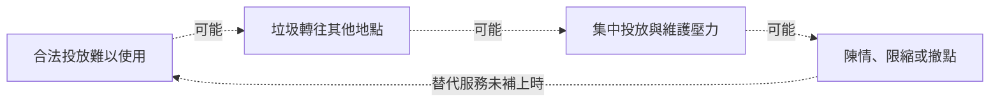

# 從投放到清運：台北垃圾回饋的完整分析

分析整理日：2026-10-17（非收集日期）

這份資料是台北市意見回饋中篩出的垃圾相關訊息。分析單位是一則留言；比例只描述這批留言，不代表全體意見回饋或台北市民意。

分析基礎：本檔 2,663 則留言；五個查核問題未逐則語意編碼，現場與因果尚未驗證。

## 投放方便與環境負擔，需要一起判斷

這批回饋提示了三種需要分開查核的困擾：外出時找不到可用的投放處、家戶作息難以配合收運，以及投放點周邊的滿溢與清潔負擔。我們的研究判斷是，先把投放到清運的完整過程看清楚，再決定要調整位置、時段、接收規則或維護。

希望增加或恢復垃圾桶，與反對住宅附近設桶，可以同時出現在這份資料中。前者可能關注沿途的方便，後者可能承擔堆積、異味與清掃負擔。因此，改善是否有用，需要同時看「使用者能否完成投放」與「周邊負擔是否減少」，也要查看問題有沒有轉往鄰近地點。

本文先區分三種情境，再追問原因與反例，最後把假說收斂成可執行的查核順序。留言是人工歸納與改寫摘述，本次未量化各立場人數，也未驗證現場；像「撤桶導致髒亂」這樣的描述，仍需核對時間順序與其他變化。

## 先辨認三種服務情境

行人投放與家戶收運是兩種不同使用情境；現場維護則決定投放點能否持續可用。下面把留言線索整理成查核問題，箭頭表示查核順序，不是人數分群或因果證明。

| 留言情境 | 先分辨 | 要補的證據 |
| --- | --- | --- |
| 行人投放：走路、轉乘、遊逛時找不到可用的桶 | 位置、辨識與實際可用性 | 沿真實路徑記錄找桶時間、繞路及投放成敗 |
| 家戶收運：上班、輪班或照顧安排難配合垃圾車 | 收運時段與替代管道 | 核對可到達的合法去處、開放時間與使用條件 |
| 現場維護：桶旁垃圾、滿溢、鼠蟲或異味的困擾 | 負荷、巡收與鄰里負擔 | 同點重複記錄桶況、清運時間與周邊垃圾 |

分開情境，是為了確認服務在哪一段難以使用。接下來要追問：路徑太遠、時段不合，還是到了現場仍不能投放？同樣的「不好丟」，可能需要不同的改善。

## 從情境追問原因與反例

以下以可達性、住宅負擔、時段、維護、垃圾來源及分類衝突為線索做目的抽樣閱讀，並保留反例；不是隨機抽樣，也未逐則語意編碼全部留言。可能機制與其他解釋均待驗證，未計算各問題的人數或發生率。

### 三個主要問題：位置、時段與維護

先沿著使用情境查核服務是否可用，逐一區分會導向不同措施的原因。

#### 找不到桶，先分辨位置、辨識與可用性

**留言線索：**留言有人希望增加或恢復投放點，也有人反對住家附近設桶。便利與鄰近負擔是兩個要同時觀察的結果。

**可能機制 · 待驗證：**可能是路徑上距離遠、看不見入口，或到了現場卻滿溢、阻塞；三者需要不同的改善方式。

**其他解釋與反例：**也有人會把垃圾帶回家，不能畫成「無桶必然亂丟」。「找不到」也可能是配置或資訊問題；若桶已順路且可用，增設未必能處理清潔問題。

**如何查核：**沿相同出發點與目的地記錄路徑、找桶秒數、繞行距離、辨識情形、投放成功與失敗原因；記下時間與現場條件。

**結果如何改變決定：**距離與繞路主導時才比較配置；接近後仍找不到入口，先比較指引；已找到卻不能投放，轉查維護。

#### 家戶收運的限制可能出在時間

**留言線索：**留言有人描述下班、輪班或照顧安排與垃圾車時間衝突，也出現希望有固定或彈性投放管道的想法。

**可能機制 · 待驗證：**即使地理上離收運點很近，開放時間與可出門時間沒有交集，服務仍可能難以使用。

**其他解釋與反例：**也有定點太遠、開放時間變動造成空跑，以及深夜垃圾車噪音的回饋。延後時段可能增加附近負擔，不能把所有家戶混投都歸因於追不到車。

**如何查核：**以自願訪談核對可投放時段、實際服務時間、步行可達性、使用條件及既有替代方式；不保存可識別個人的作息。

**結果如何改變決定：**先找出哪一段時間或條件無法使用，再比較調班、既有代收或其他替代服務；不能由留言推定接受付費。

#### 滿溢要追到負荷與巡收的時間差

**留言線索：**留言同時描述希望有桶，以及桶旁堆積、家戶垃圾混入、異味或鼠蟲的困擾；目前均是未經現場核實的描述。

**可能機制 · 待驗證：**可能是尖峰投放增加、實際清運間隔拉長、入口阻塞、容量不合用，或周邊其他垃圾來源。

**其他解釋與反例：**鼠蟲或髒亂不一定由該桶造成；留言還提到菸蒂、狗便與回收車掉落物，不能一律用行人桶處理。店家、夜市、臨時堆置等來源也需查核。

**如何查核：**同點、固定時段記錄可用容量、阻塞、滿溢、上次實際清運與清洗時間、周邊垃圾及尖峰活動；同步記錄清運工時。

**結果如何改變決定：**若問題隨清運間隔出現，先比較巡收；若空桶也不能正常投放，先查入口與設計；設備感測需有能回應的人力。

### 兩個共同問題：接收是否一致，負擔由誰承擔

位置、時段與維護之外，還有兩件事要與每種改善一起檢查：依照指引分類後，現場是否能接收；投放更方便之後，住戶、店家與清潔人員是否承擔更多負擔。

#### 分類指引與現場接收，要能接得起來

**留言線索：**留言有人描述網路指引與現場接收不同，或不同人員標準不同，也有人自述受挫後改丟一般垃圾。

**可能機制 · 待驗證：**可能是規則資訊未同步、接收條件不清，或分類收運安排與生活時段不合，使願意分類的人仍無法完成投放。

**其他解釋與反例：**不能一概歸為市民不懂分類；也不能由同車裝載就斷言後端沒有處理。車輛進入限制、袋規格與物品類別也可能影響接收。

**如何查核：**用同一組物品比對當期書面規則與現場接收，記錄日期、拒收理由及替代管道，再向承接單位確認後端流程。

**結果如何改變決定：**若規則與現場不一致，先同步指引與人員說明；若接收時段或場所受限，則回到服務安排比較，不能只增加宣導。

#### 移走一個點，還要看負擔去了哪裡

**留言線索：**希望恢復垃圾桶與反對住宅旁設桶的意見並存。這批資料沒有逐則立場編碼，不能宣稱任何一方是多數。

**可能機制 · 待驗證：**使用者得到的便利與鄰近住戶、店家、清潔人員承擔的工作和環境負擔，可能落在不同人身上。

**其他解釋與反例：**撤點後當地變乾淨，仍可能只是垃圾轉往鄰街；反過來，撤點後變髒也可能伴隨活動、商家或巡收變化。

**如何查核：**同時觀察原點與鄰近替代點，記錄街面垃圾、投放成功、異味與清潔工時；向使用者、鄰近住戶與清潔人員分別確認。

**結果如何改變決定：**試辦要同看服務可用性與周邊負擔，預先定義停止與回復條件；不能只用桶數、單點髒亂或陳情件數判定成功。

## 把可能的連鎖關係變成查核問題

前面的問題也可能相互影響。合法投放不易使用，可能讓垃圾轉往其他地點，增加維護壓力，再引發限縮或撤點。但本批留言沒有證明這些事件曾在同一地點依序發生；下圖用來決定要查什麼，不代表已成立的因果。

虛線箭頭全部是待驗證的可能關係，未證明這些事件在同一地點依序發生；也沒有估計影響大小。若替代服務未補上，限縮或撤點可能再增加投放困難。



可測試的介入點：合法去處的可用時段、依負荷調整巡收、限縮或撤點前確認替代服務。各項均須連同鄰近地點與清潔工時觀察。

### 從資料缺口到改善決定

要判斷圖中的關係是否存在，先把留言連到可核對的時間、地點與服務，再建立現場基準。接著才比較一項調整，並同時檢查使用者、鄰近地點與清潔人員的結果。以下順序是建議，尚未執行。

1. **補齊背景：**向資料提供者確認收集與篩選方式；建立能核對時間、場景與地點的清單，保留無法定位的留言。
2. **建立基準：**同點重複觀察一般與尖峰時段，對照實際收運；同看找桶、投放、街面垃圾、鄰點變化與工時。
3. **比較一項調整：**取得承接單位同意後，預先定義觀察期、成功及停止條件；保留可比的未調整場景，記錄同期活動與天候。
4. **依結果決定：**只有改善投放可用性且未把負擔推往鄰點，才考慮擴大；若比較條件不成立，保留描述結果，不宣稱因果成效。

完成條件：形成有場景、時間、服務核對及待驗證原因的問題清單；試辦前固定比較方式與停止條件。未取得現場基準前，不發布設點排名、支持率或成效估計。

## 這份資料能說到哪裡

目前最重要的資料缺口，是逐則事件時間與核實位置、實際服務時間、投放負荷、巡收及成本。缺少這些資料，仍無法區分位置、時間、容量與維護等解釋，也不能提出設點排名或成效估計。

2,663 個不重複匿名編號；無空白欄位。232 則內含換行，已依 TSV 引號規則合併為單一紀錄。有 8 組完全相同文字，比每組留一則多 10 則；全部保留，未按文字去重。

- 收集期間、招募方式、完整回饋總數、垃圾相關訊息的篩選規則均未提供；2026-10-17 是分析整理日。
- 行政區與心情沿用原檔欄位。行政區是留言標記，未確認為居住地或事件所在地；心情標籤的填寫或標註方式未知。
- 匿名編號唯一不等於已確認每人只提交一次。相同文字可能來自不同留言，不因文字相同而刪除。
- 未取得人口、曝光量與各區完整回饋數，不能比較各區問題發生率；未提供逐筆日期，不能分析趨勢。
- 原始留言留在本地。網站只呈現彙總與改寫摘述，不刊出匿名編號、逐則內容或可連結個人的細節。摘述不是逐字引言。

## 資料附錄：文字線索與留言組成

以下統計描述這份已篩選檔案的內容，不是前述五個問題的盛行率，也不能用來排序各區需求。

本檔共 2,663 則留言，涵蓋 12 個行政區標記。心情標為「生氣、無奈、擔心」的合計 2,253 則（84.6%）；這表示本檔集中呈現困擾，不能推算市民不滿意比例。

### 桶詞與垃圾車的文字交集

文字線索採固定詞表比對：先做 Unicode NFKC 正規化、移除空白，再檢查是否包含任一詞。每則留言在同組最多計一次，可跨組重複；比例不能相加。這不是逐則語意分類，不辨識否定、支持或反對，也可能漏掉同義詞。

四格互斥、合計涵蓋本檔全部留言；「未命中」只指這兩組詞，不是沒有垃圾問題。格子面積相同，不表示數量相同。這是詞語交集，不是需求分群、政策立場或因果關係。

| 文字命中 | 有垃圾車 | 無垃圾車 |
| --- | ---: | ---: |
| 有桶詞 | 47 | 1,784 |
| 無桶詞 | 157 | 675 |

分母：本檔 2,663 則；桶詞為「垃圾桶、垃圾筒、清潔箱」。

即使兩類用詞只在部分留言重疊，也不能說兩類需求彼此獨立。一個人可遇到多種困擾，留言也可能省略服務名稱。方案判斷仍要回到具體情境。

### 留言出現哪些文字線索

文字線索採固定詞表比對：先做 Unicode NFKC 正規化、移除空白，再檢查是否包含任一詞。每則留言在同組最多計一次，可跨組重複；比例不能相加。這不是逐則語意分類，不辨識否定、支持或反對，也可能漏掉同義詞。

分母：本檔 2,663 則留言。

| 欄位值 | 則數 | 占本檔比例 |
| --- | ---: | ---: |
| 垃圾桶／清潔箱 | 1,831 | 68.8% |
| 亂丟／隨地丟棄 | 230 | 8.6% |
| 家戶垃圾 | 205 | 7.7% |
| 垃圾車 | 204 | 7.7% |
| 鼠蟲／異味 | 203 | 7.6% |
| 回收／廚餘 | 195 | 7.3% |
| 菸蒂／菸頭 | 53 | 2.0% |
| 定點／彈性投放 | 52 | 2.0% |

有 377 則未命中以上詞表；未命中不代表沒有相關困擾。同時命中「垃圾桶／清潔箱」與「垃圾車」的有 47 則。

#### 詞表

- 垃圾桶／清潔箱：垃圾桶、垃圾筒、清潔箱
- 垃圾車：垃圾車
- 家戶垃圾：家庭垃圾、家戶垃圾、居家垃圾、家用垃圾
- 定點／彈性投放：定點、固定地點、24小時、二十四小時、隨時丟、隨時倒
- 亂丟／隨地丟棄：亂丟、亂扔、隨地、隨手丟、隨手扔
- 鼠蟲／異味：老鼠、鼠患、蟑螂、蚊蟲、惡臭、臭味、異味
- 菸蒂／菸頭：菸蒂、煙蒂、菸頭、煙頭
- 回收／廚餘：回收、廚餘

### 原檔的心情標籤

這是原檔提供的心情欄位，未重新做情緒推論；標註方式未知。

分母：本檔 2,663 則留言。

| 欄位值 | 則數 | 占本檔比例 |
| --- | ---: | ---: |
| 生氣 | 1,095 | 41.1% |
| 無奈 | 625 | 23.5% |
| 擔心 | 533 | 20.0% |
| 在意 | 275 | 10.3% |
| 希望改變 | 103 | 3.9% |
| 肯定 | 32 | 1.2% |

### 這批留言來自哪些行政區標記

順序沿用原檔首次出現次序。件數反映本檔組成，不是各區垃圾問題嚴重度或人口占比。

分母：本檔 2,663 則留言。

| 欄位值 | 則數 | 占本檔比例 |
| --- | ---: | ---: |
| 松山 | 233 | 8.7% |
| 信義 | 216 | 8.1% |
| 大安 | 492 | 18.5% |
| 中山 | 354 | 13.3% |
| 中正 | 211 | 7.9% |
| 大同 | 195 | 7.3% |
| 萬華 | 241 | 9.0% |
| 文山 | 135 | 5.1% |
| 南港 | 82 | 3.1% |
| 內湖 | 155 | 5.8% |
| 士林 | 210 | 7.9% |
| 北投 | 139 | 5.2% |

### 原先被歸在哪些議題

沿用原議題欄位；垃圾相關訊息也可能被歸到交通、觀光等議題。

分母：本檔 2,663 則留言。

| 欄位值 | 則數 | 占本檔比例 |
| --- | ---: | ---: |
| 環境 | 2,360 | 88.6% |
| 城市修繕 | 89 | 3.3% |
| 其他 | 69 | 2.6% |
| 交通 | 50 | 1.9% |
| 觀光 | 40 | 1.5% |
| 市政 | 32 | 1.2% |
| 教育 | 7 | 0.3% |
| 食安 | 5 | 0.2% |
| 公共安全 | 4 | 0.2% |
| 育兒 | 3 | 0.1% |
| 體育 | 1 | 0.0% |
| 長照 | 1 | 0.0% |
| 治安 | 1 | 0.0% |
| 文化 | 1 | 0.0% |


### 重現方式

原始輸入由提供者在本地保存，未納入 Git、網站或離線研究包。請使用保留的原始檔重算；僅有摘要無法重做文字比對。

在 `sites/taipei-waste-lab` 執行（離線包則在解壓根目錄）：

```sh
python3 scripts/analyze-feedback.py --input "/absolute/path/to/Pasted text.txt"
python3 scripts/package-research.py
```

不提供 `--input` 時，只從保存的 `summary.json` 重建 Markdown 與網頁。完整資料建置也會執行此步驟，不需要原始留言。

原始檔 SHA-256：`bc4d005ce9a9c4d97341204da5a576badc85c80e8ff4266e73f227ab89089851`。

彙總檔：[summary.json](summary.json)。每次變更詞表都須重新提供原始輸入；程式拒絕用舊摘要搭配新詞表。
