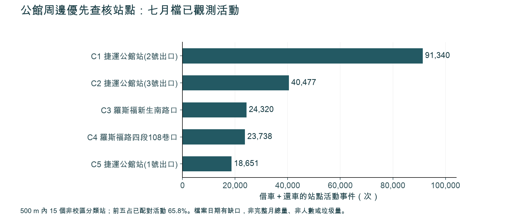
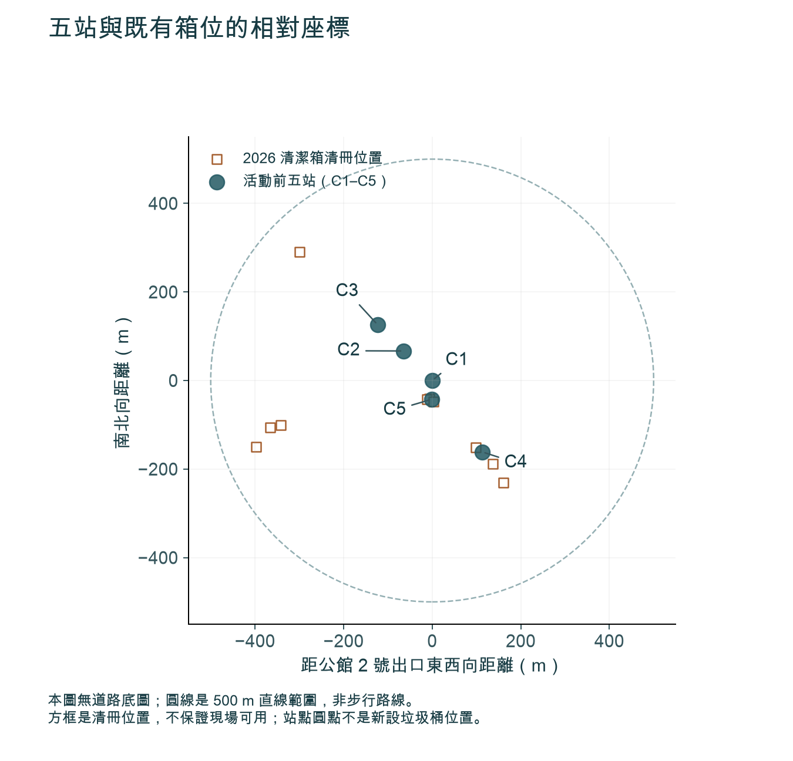
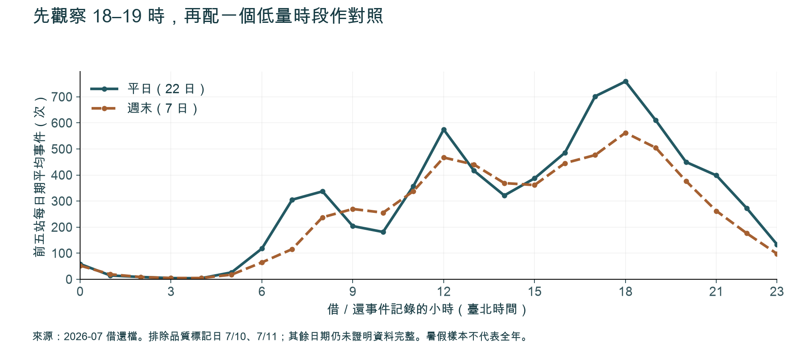

# 公館熱點分析與政府分工：桌面交付

2026-10-19。你負責的兩項桌面成果已完成；現勘、政府核准及配置原型仍未執行。

## 結論

優先查公館 2 號出口，並查其餘四處。500 m 內 15 個非校區分類站的已觀測活動為 301,904 次，前五 198,526 次，占 65.8%。其中三站距既有街道清冊紀錄不到 50 m；先確認可用、順路與滿溢，不能直接認定需要新桶。

**資料限制影響結論強度：**七月檔有缺日／異常日，數字是已觀測活動，不是完整月總量、人數或垃圾量。此結果支持現勘優先順序，不能支持全市最佳配置或改善成效。

| 順序 | 站點 | 觀測活動 | 最近 2026 清冊直線距離 | 查核重點 |
|---|---|---:|---:|---|
| C1 | 捷運公館站(2號出口) | 91,340 | 40.9 m | 先查既有桶的可用性、過街與尖峰滿溢；不可因活動最多就增桶。 |
| C2 | 捷運公館站(3號出口) | 40,477 | 121.3 m | 比對 2024 近處紀錄與現場路徑；確認資訊落差、遷移或清冊漏列，不能直接判缺桶。 |
| C3 | 羅斯福新生南路口 | 24,320 | 201.8 m | 先走查路口及 2024 近處線索；若有可用服務，優先比較指引，不把距離較遠視為增桶證據。 |
| C4 | 羅斯福路四段108巷口 | 23,738 | 17.8 m | 先查水源市場前紀錄的可用性與維護；服務對象及管理界線另查。 |
| C5 | 捷運公館站(1號出口) | 18,651 | 5.6 m | 與 C1 共享同一近處清冊線索；查出口方向與過街，避免重複計算新增需求。 |





## 方法與品質

以公館 2 號出口 (121.53438, 25.01491) 為中心，取直線 500 m。42 個啟用站中，15 個非校區分類站排序，27 個校區分類站另計；來源分類不是土地權屬。2026-07 借還檔按精確站名對應 2026-10-18 快照。借與還各算一次，同一旅程可計兩端。

官方檔有 7,596,992 列。7/11 無借車列、還車 7 列；7/10 借車 13,249 列，低於每日中位數 272,491 的 10%。不補值、不改稱零需求。借車端 22,230 次、還車端 133,671 次未匹配，保留來源名稱與數量。臺大普通教學館東側無配對活動，保持未知。

300/500/700 m 分別有 9/15/26 個非校區分類站，前五同序；追加排除 7/10、7/11 後亦同序。主規則與追加敏感度分別見 [protocol.md](protocol.md)、[quality-amendment.md](quality-amendment.md)。逐列獨立核對五站端點，球面距離交叉核算差異小於 0.02 m，見 [validation.json](validation.json)。

來源只有小時精度，沒有旅程 ID，不能核實來源重複率。七月暑假、十月站點與不同日期清冊不能當成同步現況。場所資料不是逐箱清冊，2024 記錄不是目前可用證明。公車站位檔為 2021 且缺投影定義，不納入排序；逐站公車上下車量未取得。這些限制不以代理數字填補。

## 觀察安排與下一步

前五站觀測高點為 18–19 時；排除異常日後，平日每日期 758.9 次（22 日），週末 562.1 次（7 日）。對照時段 10–11 時為 181.5／255.4 次。沒有垃圾資料，故不推定垃圾尖峰。



建議首輪 2 平日＋1 週末，五站在兩時窗各觀察 15 分鐘，共 30 站次，尚未執行。固定觀察區、時長與方法；記天候、清掃時點、桶況、散落垃圾、投放受阻、過街與可用替代。一般非干擾觀察與需進場、佔用或介入的活動分開處理，後者先確認適用許可；不得阻礙通行。

有桶但找不到時交配置成員比較指引；反覆滿溢時交清潔端查維護；只有服務缺口、通行與權責證據齊全後，才提出實際箱位。研究不代替主管機關判定，也不代送申請。

## 政府工作分配

# 公館周邊行人清潔箱熱點研究：政府工作分配提案

本文件是供後續市府協調使用的工作分配草案。各機關職掌依官方資料核對；下列主責、協作和時程均為提案，沒有機關同意、核定、指派、聯繫或參與的紀錄，也不包含預算、採購或實際設置。熱點分析由研究團隊負責；只有逐點定位並核對權責與許可後，才比較 3–5 個實際清潔箱方案的現況、原位改善與同數量調整一處方案。家戶垃圾不在本期範圍。權屬未明不阻止桌面分析，也不將一般公開空間的無設備、不佔位、不干擾觀察一律設為須先申請；進入受管制場域或進行設備、標誌、移桶、佔用等介入時，依場域規則確認並先取得所需許可。

目前分析提供五個距離捷運公館站 2 號出口 500 公尺內的**活動／現場觀察錨點**，供排序與安排後續現場觀察使用；它們不是清潔箱的建議座標，也不代表土地權責或設置同意。計數為 2026 年 7 月來源檔的觀測端點數，並非即時人流或垃圾量。分析指出排除 7 月 10–11 日異常日後，排序不變。公車位置資料僅有 2021 年檔案且缺少座標參考系統，本次沒有公車運量資料，因此不能用於判定現行站位或站點需求。

| 錨點 | 位置名稱 | 觀測端點數 | 使用限制 |
|---|---|---:|---|
| C1 | 捷運公館站（2 號出口） | 91,340 | 車站活動錨點，不是設點座標 |
| C2 | 捷運公館站（3 號出口） | 40,477 | 車站活動錨點，不是設點座標 |
| C3 | 羅斯福新生南路口 | 24,320 | 路口活動錨點；逐點座標、行政區與管理者待查 |
| C4 | 羅斯福路四段 108 巷口 | 23,738 | 路口活動錨點；逐點座標、行政區與管理者待查 |
| C5 | 捷運公館站（1 號出口） | 18,651 | 車站活動錨點，不是設點座標 |

環保局適合作為清潔箱服務的提案協調機關：官方說明新設、拆除或遷移可由里長或 1999 反映，由清潔隊檢核；一般情形以人行道總寬至少 1.5 公尺為申請場地原則，並考量人潮與交通影響。這不是清潔箱放置後的行人通行淨寬；實際箱位須另依適用現場規範核實設置後淨空，不在未核實時填入數值。[S01] 區清潔隊清理轄區行人清潔箱，直屬清潔隊另負責全市清潔箱修護及拆裝。[S02–S05] 這些職掌不等於環保局可以核准所有土地上的設施；每個候選點仍須確認土地、道路及設施管理者。

## 已核實職掌與提案分工

| 項目 | 官方已核實的職掌 | 本案提案責任 |
|---|---|---|
| 清潔箱需求與營運 | 環保局管理環境清潔；大安、中正區清潔隊負責各自轄區清潔箱清理，直屬清潔隊負責清潔箱修護、拆裝。[S01–S05] | 環保局環境清潔管理科統籌服務需求、清運維護方案與單一案件分流；實際區隊依候選點座標確認其行政區後再邀請。 |
| 道路與人行空間 | 新工處養護工程隊職掌包括市區道路土地與財產管理、道路及人行道巡查維護和道路使用申請審核；若設施物影響人行淨寬，須洽該設施權屬單位處理。[S06–S07] | 新工處先核對市區道路／人行道範圍並協調權責查核；場地仍須按地籍及設施界線確認主要管理者與全部必要核准者。不得把道路養護職掌等同於所有土地及附屬設施均由新工處核准。 |
| 交通安全 | 交工處負責交通改善規劃、交通資料，以及標誌、標線、號誌與安全設施。[S08] | 交工處就視距、動線與交通影響提出審查意見；道路管理者與環保局共同確認通行淨空。 |
| 公車與 YouBike | 公運處規劃公共運輸場站，管理市區公車營運及站位；交通局委託營運商建置、營運 YouBike，並處理既有站點及自行車路網。[S09–S11] | 只有候選點碰到公車站、YouBike 站或其必要動線時，才加入交通局／公運處與營運商協調。 |
| 地方溝通 | 大安、中正區公所民政課處理自治、環境衛生等區政事項，里鄰聯繫可協助地方說明。[S12–S13] | 由環保局按候選點實際座標與行政區界線邀請大安或中正區公所協助地方說明；區公所及里辦公處不被視為土地核准者，也不依捷運站來源區推定。 |
| 其他場域 | 公園處管理公園、綠地、廣場等；臺大總務處管理校地與校園設施；北水處管理自來水園區；北捷公司負責捷運站務。[S14–S18] | 只在座標落入相應土地或站區時，請該場域管理者確認使用程序，並列出其他必要核准單位。附近、相鄰或地圖標示本身不足以證明土地權責。 |

完整工作包、輸入、交付、驗收、交接與阻塞條件見 [government.json](government/government.json)。每包只有一個「提案 accountable lead」；這是工作分配建議，不是法定權責移轉或機關承諾。

| 工作包 | 提案 accountable lead | 主要交付 | 土地權責未明時 |
|---|---|---|---|
| WP01 範圍與協調啟動 | 環保局 | 固定研究範圍、候選清單版本、待確認清冊 | 可先做桌面工作；不能據此推定可進入受管制場域或進行介入，也不能推定箱位可設 |
| WP02 活動熱點與觀察錨點排序 | 研究團隊 | 五個活動／觀察錨點與可回查分析 | 錨點不得當成箱位座標；未定位及核准前不得推薦設點 |
| WP03 土地與道路權責確認 | 新工處（提案協調主責） | 每個觀察錨點／箱位候選的管理者及許可條件分類 | **具體箱位、受限進入及介入行動須逐點確認**；權屬未明不阻塞桌面分析或一般公開空間不干擾觀察 |
| WP04 通行、交通與安全檢視 | 交工處 | 箱位方案的交通與通行檢核；分列人行道總寬與設置後淨空 | **箱位方案須確認適用淨空與安全條件才能定案**；此審查不阻塞一般公開空間不干擾觀察 |
| WP05 公運節點介面 | 交通局 | 公車／YouBike／捷運衝突檢核 | 只有實際重疊才啟動；未查明站區土地前不畫定設置範圍 |
| WP06 清運維護與地方協調 | 環保局環境清潔管理科 | 區隊、拆裝、巡查及地方協作方案 | 行政區或管理者不明時，先不指定區隊或里辦公處 |
| WP07 現場觀察 | 研究團隊 | 不介入式觀察紀錄、場域規則與許可狀態註記 | 一般公開通行區先核對場域規則與安全條件；受限進入或介入行動依規則先取得必要許可 |
| WP08 三方案比較 | 環保局 | 現況／原位改善／同數量調整比較 | 只比較已確認可管理的候選點；其餘保留阻塞狀態 |
| WP09 試辦申請準備 | 環保局 | 待核准的決策包與必要附件清單 | **未取得主要管理者及全部必要主管機關的書面許可，不採購、不安裝** |
| WP10 試辦監測與案件分流 | 環保局 | 條件式監測方案、問題清冊與結案判斷 | 無正式核准就不啟動試辦；問題只記非識別資訊 |

## 建議階段與停止條件

以下以研究團隊確認本提案為 T0，採相對週次估算，供排程討論；不是機關服務時限、法定期限或政府已同意的時程。

1. **T0–第 1 週，桌面篩選：** 研究團隊固定資料版本與範圍，整理五個活動／觀察錨點、排序依據和限制；比對既有箱及有日期、座標依據的交通節點資料。這些錨點不當作箱位座標；產出待現勘問題，並把尚未形成的實際箱位候選列為未完成。
2. **第 2 週，場域與行動分類：** 新工處先核對市區道路及人行道維護範圍；依逐點座標和實際場域，區分一般公開通行區觀察、受限制場域進入，以及箱位／設備等介入行動。大安、中正及羅斯福路兩側均按逐點座標核對行政區與道路界線，不依捷運來源區推定區隊、區公所或土地管理者。權屬不明不停止桌面分析；具體箱位、受限進入及需許可的介入行動，才逐項確認主要管理者與全部必要核准者。
3. **第 3 週，箱位通行與交通預審：** 對具體清潔箱方案，由交工處、道路管理者、環保局及相關設施權屬單位檢視視距、行人流線、維護動線和交通影響。環保局公開的通常 1.5 公尺原則是申請場地的人行道總寬條件，不是放置箱體後的行人淨寬；後者須另依核實的適用現場規範確認，不在未核實時給出數值。這些箱位審查不阻塞一般公開空間的不干擾觀察。[S01、S07]
4. **第 4 週，條件式現場觀察：** 一般公開通行區以無設備、不佔位、不移動設施、不妨礙通行的方式觀察；不把這類觀察一律設定為須先取得管理者許可，也不宣稱一律免申請。先核對現場告示及適用規則；若要進入非公開／受管制場域，或放置設備／標誌、移桶、佔用空間，須先按場域規則確認並取得該行動所需許可，規則不明時暫停查明。提案基線為 2 個平日加 1 個週末日；C1–C5 各於 10–11 時及 18–19 時窗內觀察 15 分鐘，共 30 站次。此為未執行的最小基線，不是機關承諾。記錄時段、天候、活動或施工等影響；不拍攝或保存可識別個人資料。若觀察會妨礙通行或有安全疑慮，停止並改期或保留未驗證狀態。
5. **第 5–6 週，方案與決策包：** 只有已精確定位、完成權責核對且資料足夠的實際箱位候選，才比較現況、原位改善、同數量調整一處；列出每案管理者、全部必要核准者、服務路線、維護責任、風險與待核文件。若未形成實際箱位座標或權責未明，只交付比較框架及阻塞清單，不推薦進入試辦。
6. **試辦階段（另案、取得核准後）：** 只有在主要場域管理者及全部必要主管機關書面同意、環保局確認清運維護安排、預算與採購程序完成後才可啟動。可提議先做 4 週監測作為排程假設；起訖與延長由市府核定。開始前固定成功門檻，追蹤箱體使用／滿溢、周邊散落垃圾、清運維護、行人淨空與現場安全。若發生通行受阻、交通安全疑慮、箱體衛生／安全異常或服務無法維持，立即暫停並由權責機關處理。

### 分層停止條件

- **桌面分析：** 權屬未明不構成停止條件；持續標記待核事項，不把錨點排序寫成可設置地點。
- **一般公開空間的不干擾觀察：** 只在一般公開通行範圍進行，不放設備、不佔位、不移動清潔箱且不妨礙通行。先查現場告示及適用規則；若公開通行範圍或規則不明、告示要求申請、管理者要求停止，或出現安全／通行風險，暫停該次觀察並查明。此提案不預設一律需要許可，也不保證免許可。
- **受限場域或物理介入：** 若進入非公開／受管制空間，或需放置設備／標誌、移動清潔箱、佔用空間或改變現況，先確認主要管理者、全部必要核准者和場域程序；所需許可未取得前，不執行該行動。
- **具體箱位方案：** 土地及設施權責、全部必要核准者、交通安全和放置後通行淨空均須逐點核實。環保局通常要求申請場地的人行道總寬至少 1.5 公尺；這不是設置後的行人淨寬。設置後的適用淨空規範尚未核實前，不定案、不自行填入未證實的數值。[S01]
- **任何觀察：** 若活動會迫使行人進入車道、阻擋通行或緊急動線，或現場發生即時危害，立即停止；施工、活動或異常天候造成樣本失真時，註記並改期或保留未驗證狀態。

## 單一案件入口與分流

對外建議只使用臺北市 1999 陳情系統作為本案共同入口。清潔箱新設、拆除或遷移可經 1999 反映；系統按案件類別導向權責機關，並提供案件查詢。[S01、S17] 1999 表單建議一案一事；若是不同問題，分開立案。[S19] 環保局作為本案提案協調者，按內容分流至清潔隊、道路管理者、交工處、交通局／公運處或已確認的場域管理者。緊鄰里辦公處不改變土地管理權責。

研究團隊只維護不含姓名、電話、電子郵件或身分證字號的內部問題紀錄；如 1999 欄位要求個人資料，由反映者自行提交，團隊不代收、不代填，也不代替市民立案。記錄欄位限案件類別、位置、觀察時間、狀態與必要的 1999 案號。不要另建機關個人聯絡清單。

## 官方一手來源（查閱日：2026-10-19）

下列內容均為簡短轉述；官方職掌核對不等於個案權責、土地同意或法律意見。道路與人行道維護職掌可協助安排查核順序，但不能替代地籍、設施界線、管理者書面確認或可能存在的多重許可。

- [S01 環保局：清潔箱新設、拆除、遷移申請](https://www.dep.gov.taipei/News_Content.aspx?n=ACEFA960B5A4ACD7&s=B90A10FBBF73521B)：可由里長或 1999 反映；清潔隊檢核；申請場地的人行道總寬原則為 1.5 公尺以上（不代表設置後的行人淨寬），並考量人潮與交通。
- [S02 環保局：組織架構及區清潔隊職掌](https://www.dep.gov.taipei/cp.aspx?n=DD34C671F97B74E5)：環境清潔管理科規劃環境清潔、垃圾清運；區清潔隊清理行人專用清潔箱。
- [S03 環保局：直屬清潔隊職掌](https://www.dep.gov.taipei/News_Content.aspx?n=ACBF29804BAC5495&s=7BF4AC711A54C143)：直屬隊負責行人清潔箱修護與拆裝。
- [S04 中正區清潔隊職掌](https://www.dep.gov.taipei/News_Content.aspx?n=ACBF29804BAC5495&s=7698074CB30A9329) 與 [S05 大安區清潔隊職掌](https://www.dep.gov.taipei/News_Content.aspx?n=ACBF29804BAC5495&s=24F7765F14339E52)：兩隊各自負責轄區清潔及行人專用清潔箱清理。
- [S06 新工處養護工程隊職掌](https://nco.gov.taipei/News_Content.aspx?n=EF8BCD0B3D07B082&s=37A6FB2ACE0C25A8&sms=73A5113E33DDEA76) 與 [S07 人行道設施物妨礙通行說明](https://nco.gov.taipei/News_Content.aspx?n=9B1841F5C8EEDA23&s=5E7A3A28AFDA77EF)：新工處負責市區道路土地與財產管理及道路、人行道巡查維護；若設施物影響人行空間，須洽設施所屬單位研議，顯示管理與核准權可能分屬不同機關。
- [S08 交工處組織架構](https://bote.gov.taipei/cp.aspx?n=15E4D7CDB56449D0)：交通改善規劃、交通資料、標誌標線號誌及安全設施由相應單位辦理。
- [S09 公運處組織架構](https://pto.gov.taipei/cp.aspx?n=B6925ED7DB64D519) 與 [S10 大眾運輸科職掌](https://pto.gov.taipei/News_Content.aspx?n=E9904C4AEF4C0B73&s=198ADD9BEFB9E915&sms=DDAD902E541DC448)：包含公共運輸場站規劃，以及公車路線、站位管理。
- [S11 交通局：公共自行車簡介](https://dot.gov.taipei/News_Content.aspx?n=44C34CB5F656CF90&s=2982E80C499FE909)：交通局委託業者建置營運 YouBike，並以既有場站與自行車路網為工作重點。
- [S12 中正區公所民政課職掌](https://zzdo.gov.taipei/News_Content.aspx?n=4B8B2E034E9B2D26&s=C373C549443946F0&sms=4F08E1FFBBA66DEC) 與 [S13 大安區公所民政課職掌](https://dado.gov.taipei/News_Content.aspx?n=9CC1E077CCD21A4C&s=2B773C8EB86A15B8&sms=003F7E38F9344C1B)：含環境衛生及地方清潔協調事項。
- [S14 公園處職掌](https://pwd.gov.taipei/News_Content.aspx?n=6547330FAEB8433C&s=E992220470EE45FE&sms=1AF8D4799C869656)：公園、綠地、廣場及行道樹管理維護。
- [S15 臺大總務處組織及職掌](https://ga.ntu.edu.tw/main_ch/docDetail/59/0/464/)：保管組管理土地與建物財產，營繕組維護校園設施。
- [S16 北水處展業科職掌](https://www.water.gov.taipei/News_Content.aspx?n=0B4AB94CB6E735FC&s=D365733B9B5DF0A0)：包括自來水園區經營管理，以及園區設施維護。
- [S17 臺北市 1999 受理流程](https://1999.gov.taipei/front/Accept/CasLogin)：案件分類、受理及進度查詢；申訴流程會要求反映者提供資料。
- [S18 北捷公司組織職掌](https://www.metro.taipei/cp.aspx?n=3c7a1f15a9e6fa91&s=D9B7A5B53F3838E4)：站務處掌理捷運系統站務；只有候選點涉及站區管理時才列入協調。
- [S19 臺北市 1999 線上通報表單](https://1999.gov.taipei/front/Accept/EocLogin/EocForm)：表單建議一案一事，並有案件地點、敘述及通報人資料欄位。

## 目前未能由本次資料確認

本工作包目前只有五個活動／觀察錨點名稱與觀測端點數，沒有清潔箱建議座標、地籍地號或權管機關書面回覆；因此不能判定任何點屬新工處道路、公園、臺大、自來水園區、捷運或其他管理範圍，也不能判斷清潔箱是否獲准。大安與中正的逐點行政區、道路兩側、地籍及管理者均待核，捷運來源區不作為權責證據。尚未取得機關回覆、場域許可、經費、採購安排、現場觀察或試辦成效。下游整合時須由熱點分析輸出逐點列出精確觀察位置與資料版本。桌面分析及一般公開空間的不干擾觀察可依分層條件進行；若提出具體箱位、需進入受限制場域或採取物理介入，再完成 WP03 權責及所需許可核對。若有多個核准機關，須分別列出，不以一個協調窗口取代各自許可。


## 重現與交付檔

- 原始 ZIP：交付資料夾 `raw/202607-youbike.zip`；來源 URL、SHA-256 與保留位置見 [manifest.json](manifest.json)。官方目錄：[YouBike 租借紀錄](https://data.gov.tw/dataset/150635)。
- [analysis.ipynb](analysis.ipynb)：可執行研究筆記，已存表格與圖形輸出。
- [results/stations.csv](results/stations.csv)：700 m 內全站結果，沒有只保留前五。
- [results/hourly.csv](results/hourly.csv)、[results/quality-hourly.csv](results/quality-hourly.csv)：站點日期小時資料與追加分時敏感度。
- [government/government.json](government/government.json)：10 個工作包、職掌、來源與交接條件。

在本目錄、已安裝 `requirements-analysis.txt` 的 Python 環境：

```sh
python analyze.py --archive /path/to/202607-youbike.zip
python quality.py
python validate.py --archive /path/to/202607-youbike.zip
python figures.py
```

Notebook 可設定環境變數 `GONGGUAN_ARCHIVE` 指向同一 ZIP 後從頭執行。原始來源、清冊副本、結果與 notebook 保留在私人交付包；公開網站只發布摘要與圖形，不開放原始附件。

`publish_results.py` 另供原網站 source checkout 重新產生公開摘要及報告；它會更新網站的 `dist/index.html`，不屬於私人研究包的獨立重算步驟。

## 90 秒講稿

我負責的是熱點分析與政府部門工作分配。我們用公館周邊實際保存的 YouBike 借還紀錄，挑出五個優先觀察位置。它們占區內非校區分類站已觀測活動約三分之二，但這不是垃圾量；原始月份還有兩個日期品質問題。

最重要的發現是，五處裡有三處離既有垃圾桶清冊不到五十公尺。因此我們不先說要多放桶，而是查桶能不能用、是不是順路，以及尖峰有沒有滿溢。若問題是資訊或維護，就先處理資訊和維護。

政府分工建議由環保局統籌清潔箱服務，清潔隊確認清運與維護，交通單位處理動線與運輸介面，實際道路或場地管理者確認權責。每一步都有交付與停止條件；還沒取得機關同意的部分都標成提案。這讓分析可以接到下一位成員的配置比較，而不把桌面推估當成已核准的設點方案。
