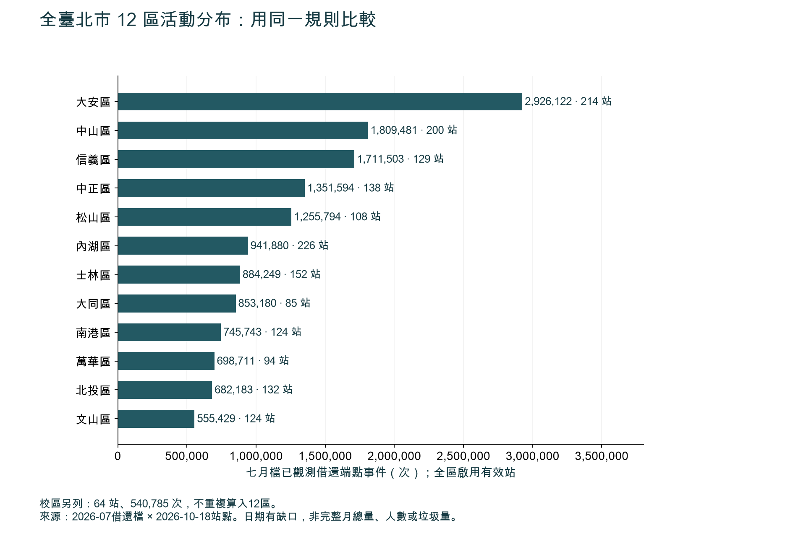
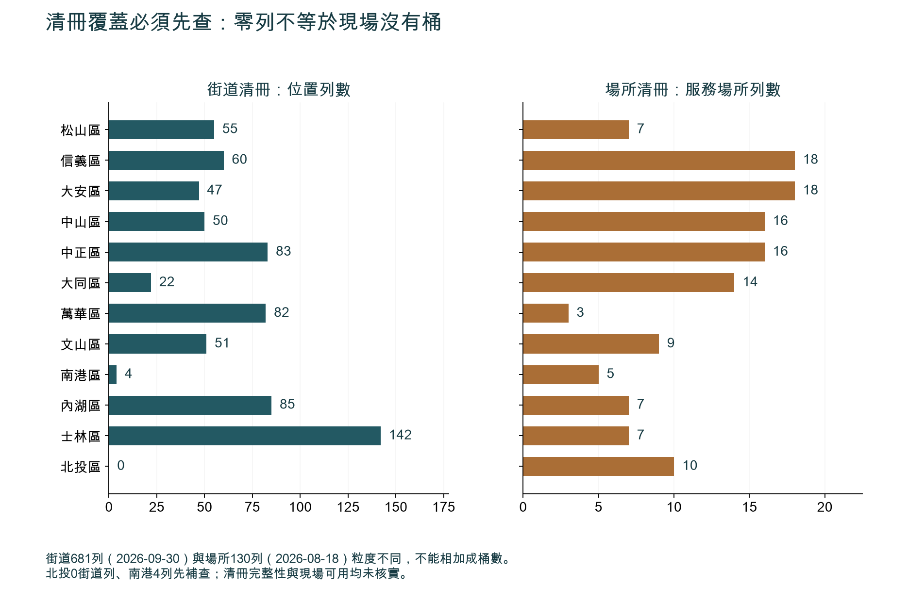
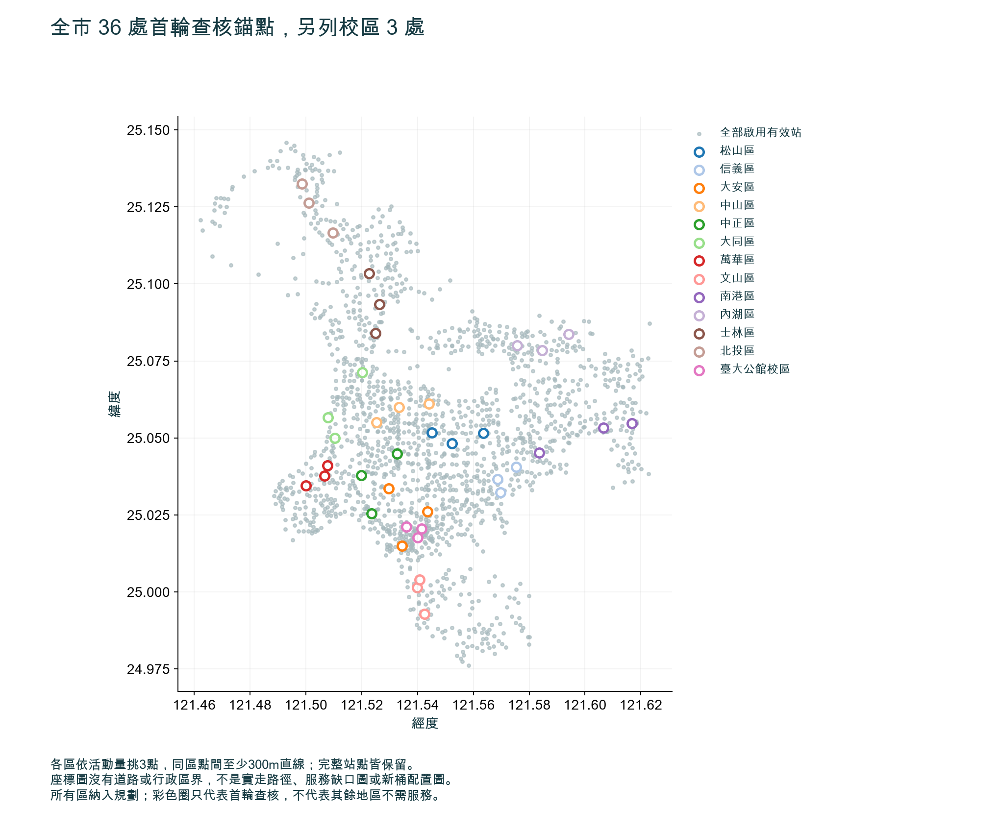

# 全臺北市12區：熱點分析與政府部門工作分配

2026-10-19。依使用者修正，規劃範圍為全臺北市；原公館成果降為局部案例。這是桌面規劃交付，非已現勘、已核准或已實施設點。

## 結論

完整保留1,821站，分析1,790個啟用有效站：12區分類1,726站／14,415,869個已觀測借還端點，臺大校區另64站／540,785次，不重複加總。全部12區各3個首輪查核點共36處，校區另3處；全站表與47個無配對觀測站保持未知，不以篩選名單代替全市服務。

每區同步資料查核。北投0街道列、南港4列先補清冊，不因缺列判無桶或低需求。依現勘證據分為資訊可達性、維護清運、補資料及配置條件四路；市級標準與跨機關協調，各區依實際權責執行。





## 12區與校區首輪查核表

按觀測活動量排序、同區選點至少300m直線。此規則是在城市級計算前固定；各區三點是首輪查核額度，並非需求或預算均分。完整結果見results/stations.csv。

| 區域 | 首輪錨點 | 已觀測端點 | 最近街道紀錄直線距離 | 工作方向 |
|---|---|---:|---:|---|
| 松山區 | D01-1 捷運南京三民站(1號出口) | 44,875 | 23.0 m | 先核實既有街道紀錄的可用、步行與維護 |
| 松山區 | D01-2 臺北市藝文推廣處 | 29,859 | 92.6 m | 先核實既有街道紀錄的可用、步行與維護 |
| 松山區 | D01-3 捷運南京復興站(5號出口) | 28,929 | 200.9 m | 先補清冊、場所及實際路徑；不能判缺桶 |
| 信義區 | D02-1 捷運永春站(2號出口) | 51,984 | 493.4 m | 先補清冊、場所及實際路徑；不能判缺桶 |
| 信義區 | D02-2 松仁路95巷口 | 46,333 | 161.4 m | 先補清冊、場所及實際路徑；不能判缺桶 |
| 信義區 | D02-3 捷運象山站(2號出口) | 40,859 | 80.5 m | 先核實既有街道紀錄的可用、步行與維護 |
| 大安區 | D03-1 捷運公館站(2號出口) | 91,340 | 40.9 m | 先核實既有街道紀錄的可用、步行與維護 |
| 大安區 | D03-2 捷運科技大樓站 | 56,631 | 169.7 m | 先補清冊、場所及實際路徑；不能判缺桶 |
| 大安區 | D03-3 捷運東門站(5號出口) | 55,312 | 399.7 m | 先補清冊、場所及實際路徑；不能判缺桶 |
| 中山區 | D04-1 捷運中山國中站 | 59,123 | 22.5 m | 先核實既有街道紀錄的可用、步行與維護 |
| 中山區 | D04-2 捷運行天宮站(3號出口) | 40,097 | 290.8 m | 先補清冊、場所及實際路徑；不能判缺桶 |
| 中山區 | D04-3 林森長春路口 | 34,674 | 533.0 m | 先補清冊、場所及實際路徑；不能判缺桶 |
| 中正區 | D05-1 中正運動中心 | 29,939 | 98.6 m | 先核實既有街道紀錄的可用、步行與維護 |
| 中正區 | D05-2 光華商場 | 27,141 | 359.6 m | 先補清冊、場所及實際路徑；不能判缺桶 |
| 中正區 | D05-3 捷運古亭站(2號出口) | 27,084 | 226.4 m | 先補清冊、場所及實際路徑；不能判缺桶 |
| 大同區 | D06-1 捷運圓山站(1號出口) | 53,258 | 326.7 m | 先補清冊、場所及實際路徑；不能判缺桶 |
| 大同區 | D06-2 大稻埕碼頭 | 35,942 | 634.0 m | 先補清冊、場所及實際路徑；不能判缺桶 |
| 大同區 | D06-3 捷運北門站(3號出口) | 28,336 | 193.0 m | 先補清冊、場所及實際路徑；不能判缺桶 |
| 萬華區 | D07-1 中華桂林路口 | 36,357 | 108.2 m | 先補清冊、場所及實際路徑；不能判缺桶 |
| 萬華區 | D07-2 西本願寺廣場 | 29,449 | 25.5 m | 先核實既有街道紀錄的可用、步行與維護 |
| 萬華區 | D07-3 萬華區公所(大理街) | 27,345 | 799.8 m | 先補清冊、場所及實際路徑；不能判缺桶 |
| 文山區 | D08-1 捷運萬隆站(2號出口) | 22,821 | 483.2 m | 先補清冊、場所及實際路徑；不能判缺桶 |
| 文山區 | D08-2 台北花木批發市場 | 21,348 | 488.8 m | 先補清冊、場所及實際路徑；不能判缺桶 |
| 文山區 | D08-3 景行公園 | 12,947 | 771.0 m | 先補清冊、場所及實際路徑；不能判缺桶 |
| 南港區 | D09-1 捷運南港展覽館站(5號出口) | 23,669 | 822.7 m | 先補清冊、場所及實際路徑；不能判缺桶 |
| 南港區 | D09-2 南港車站(市民大道) | 22,779 | 1125.2 m | 先補清冊、場所及實際路徑；不能判缺桶 |
| 南港區 | D09-3 捷運後山埤站(3號出口) | 22,512 | 843.9 m | 先補清冊、場所及實際路徑；不能判缺桶 |
| 內湖區 | D10-1 捷運港墘站(1號出口) | 21,400 | 162.6 m | 先補清冊、場所及實際路徑；不能判缺桶 |
| 內湖區 | D10-2 捷運文德站(2號出口) | 19,789 | 172.3 m | 先補清冊、場所及實際路徑；不能判缺桶 |
| 內湖區 | D10-3 捷運內湖站(1號出口) | 19,061 | 50.9 m | 先核實既有街道紀錄的可用、步行與維護 |
| 士林區 | D11-1 捷運芝山站(2號出口)_1 | 50,703 | 958.6 m | 先補清冊、場所及實際路徑；不能判缺桶 |
| 士林區 | D11-2 劍潭基河路口 | 30,261 | 41.8 m | 先核實既有街道紀錄的可用、步行與維護 |
| 士林區 | D11-3 捷運士林站(2號出口) | 25,823 | 162.7 m | 先補清冊、場所及實際路徑；不能判缺桶 |
| 北投區 | D12-1 捷運北投站(1號出口) | 35,253 | 3309.4 m | 先補清冊、場所及實際路徑；不能判缺桶 |
| 北投區 | D12-2 捷運奇岩站(三合街) | 25,151 | 2905.7 m | 先補清冊、場所及實際路徑；不能判缺桶 |
| 北投區 | D12-3 北投運動中心 | 24,714 | 1749.9 m | 先補清冊、場所及實際路徑；不能判缺桶 |
| 臺大公館校區 | U-1 臺大第一活動中心西南側 | 31,310 | 377.4 m | 先補清冊、場所及實際路徑；不能判缺桶 |
| 臺大公館校區 | U-2 臺大新體育館東南側 | 27,201 | 223.3 m | 先補清冊、場所及實際路徑；不能判缺桶 |
| 臺大公館校區 | U-3 臺大社科院西側 | 17,343 | 454.3 m | 先補清冊、場所及實際路徑；不能判缺桶 |



## 分區時段

活動峰值依排除7/10、7/11後的各區全部啟用有效站計算；平日22日、週末7日。不是已確認垃圾尖峰。

| 區域 | 平日活動／對照 | 週末活動／對照 |
|---|---|---|
| 松山區 | 18–19時／10–11時 | 18–19時／10–11時 |
| 信義區 | 18–19時／10–11時 | 17–18時／10–11時 |
| 大安區 | 18–19時／10–11時 | 18–19時／10–11時 |
| 中山區 | 18–19時／10–11時 | 18–19時／10–11時 |
| 中正區 | 18–19時／10–11時 | 18–19時／10–11時 |
| 大同區 | 18–19時／10–11時 | 18–19時／10–11時 |
| 萬華區 | 18–19時／10–11時 | 18–19時／10–11時 |
| 文山區 | 18–19時／10–11時 | 18–19時／10–11時 |
| 南港區 | 18–19時／10–11時 | 17–18時／10–11時 |
| 內湖區 | 08–09時／10–11時 | 17–18時／10–11時 |
| 士林區 | 18–19時／10–11時 | 17–18時／10–11時 |
| 北投區 | 17–18時／10–11時 | 17–18時／10–11時 |
| 臺大公館校區 | 17–18時／10–11時 | 12–13時／10–11時 |


每區3點×3日×兩時窗×15分鐘＝18站次／4.5純觀察小時；全12區216站次／54小時；校區另18站次／4.5小時。不含交通、整理、陪同與重訪；沒有排班、人力或預算承諾。固定記錄日期、天候、清掃時點、桶況、垃圾事件、投放受阻、過街與替代服務。一般公開不干擾觀察與受管制進入、設備、佔用或移桶分開確認適用條件。

## 方法、敏感度與限制

原始ZIP7,596,992列，7/11無借車、7筆還車，7/10借車13,249列；品質原因未知。借端未匹配22,230次、還端133,671次；不補值、不模糊配對、不推定零需求。31站停用不入主排序。來源無旅程ID、只有小時精度，無法驗證重複率。暑假與跨期站點不代表全年同步現況。

排除兩日期後各區前三點均相同；150／500m點間隔使部分名單變動，完整比較見results/sensitivity.csv。不同空間門檻回答不同訪查分散程度，不挑選最好看的設定。全部站點端點計數與先前全檔站名彙總獨立核對，候選點與距離用不同球面公式交叉核對；見validation.json。規則在protocol.md，來源與雜湊在manifest.json。

街道681列中680列座標可用，場所130列不是逐箱，2024只供反例。未核實全市清冊完整性、現場箱況及步行可達。回饋2,663則不是代表性樣本，區標記未核實事件地，不能把回饋量當垃圾量。逐區A/C類留言計數與分母見results/districts.csv；不加入排名分數。

分區沿官方sarea，65筆校區來源站（64啟用）另列，未作地籍或行政界判定。公車逐站人流、行人、商圈、垃圾事件、路網、清運能力及成本仍缺；全市規劃必須安排這些補件，而不是把YouBike代理當成全部需求。

## 政府工作分配

# 臺北市12行政區行人清潔箱熱點查核與政府分工提案

本文件把工作範圍定為臺北市12行政區。公館研究留作歷史個案，不代表全市。這是分工與查核提案；來源只用來核實機關公開職掌，沒有機關接受、指派、接觸或核准的紀錄，也沒有提出預算、採購或實體設置。

## 規劃基線

全市桌面篩選使用2026年10月18日YouBike站點快照：1,821筆，其中1,790筆標示啟用。另將臺大公館校區65筆來源類別列成校園管理序列，這65筆已包含在1,821筆內，不重複加總，也不以資料分類推定土地權屬。借還端點事件是活動代理指標，不是獨立人數、行人流量、垃圾量或清潔箱需求。

2026年9月30日公開街道清冊有681列，2026年8月18日場域線索有130筆；兩層粒度不同，分開呈現，不相加成清潔箱數。公開街道清冊的北投區0列與南港區4列，列為資料覆蓋及服務核對事項，不能解讀成現場零桶、四桶或低優先。

分析規則、分母及觀察時窗依[全市分析protocol](protocol.md)固定。12區的桌面篩選同步開始；各區按相同規則保留全站清單並各取3個空間分散的首輪觀察錨點。臺大校園序列另取3點。這39個錨點是活動查核與現場觀察位置，不是清潔箱座標、建議位置或核准。

## 已核實職掌與提案安排

臺北市環保局組織資料列出依12個行政區設置的區清潔隊。區隊公開職掌包括轄區道路清潔及行人專用清潔箱清理；直屬清潔隊公開職掌包括行人清潔箱修護及拆裝。環保局問答說明清潔箱新設、拆除或遷移可由里長或1999反映、由清潔隊檢核；通常1.5公尺條件指申請場地的人行道總寬，不是放置清潔箱後的通行淨寬。[S01](#s01) [S02](#s02) [S03](#s03)

市府組織頁說明12區公所為市府派出機關並掌理區政工作。提案安排區公所協調地方脈絡；這不等於土地、設施或道路核准權。提案由環保局環境清潔管理科統籌全市清潔箱議題，由各區清潔隊作為建議的地方執行隊伍。這些都是建議分工，須由機關確認後才可能成為實際工作安排。[S02](#s02) [S20](#s20)

新工處公開職掌包括市區道路土地及財產管理、巡查維護與道路使用申請審核；新工處另說明人行道設施物影響通行時須洽設施所屬單位研議。這支持把道路管理者與設施權屬單位分開核對，不代表任何候選點都由新工處管理。交工處負責交通規劃及交通設施；公運處處理公共運輸規劃、場站、公車路線與站位事項；交通局說明其委託營運YouBike。上述單位只在實際位置或設施介面重疊時納入。[S06](#s06) [S07](#s07) [S08](#s08) [S09](#s09) [S10](#s10) [S11](#s11)

公園處、臺大總務處、北水處與北捷的官方職掌可作條件式場域查核線索；要先確認具體位置及設施是否真的落入其管理範圍。市府1999提供案件受理、分類及進度查詢，線上說明建議一案反映一件事。[S14](#s14) [S15](#s15) [S16](#s16) [S18](#s18) [S17](#s17) [S19](#s19)

## 12區建議執行單位

| 行政區 | 建議地方執行隊伍 | 地方協調 | 本區第一輪交付 |
|---|---|---|---|
| 松山 | 松山區清潔隊 | 松山區公所 | 3個錨點；18站次或逐站次註記未完成原因；資料與權責待核項 |
| 大安 | 大安區清潔隊 | 大安區公所 | 同一套全市表格及18站次狀態 |
| 中正 | 中正區清潔隊 | 中正區公所 | 同一套全市表格及18站次狀態 |
| 中山 | 中山區清潔隊 | 中山區公所 | 同一套全市表格及18站次狀態 |
| 大同 | 大同區清潔隊 | 大同區公所 | 同一套全市表格及18站次狀態 |
| 萬華 | 萬華區清潔隊 | 萬華區公所 | 同一套全市表格及18站次狀態 |
| 文山 | 文山區清潔隊 | 文山區公所 | 同一套全市表格及18站次狀態 |
| 南港 | 南港區清潔隊 | 南港區公所 | 清冊4列先做覆蓋核對；完成3個錨點與18站次狀態 |
| 內湖 | 內湖區清潔隊 | 內湖區公所 | 同一套全市表格及18站次狀態 |
| 士林 | 士林區清潔隊 | 士林區公所 | 同一套全市表格及18站次狀態 |
| 北投 | 北投區清潔隊 | 北投區公所 | 清冊0列先做覆蓋核對；完成3個錨點與18站次狀態 |
| 信義 | 信義區清潔隊 | 信義區公所 | 同一套全市表格及18站次狀態 |

表內「建議地方執行隊伍」及交付都是提案，不代表這些單位已承諾派員。區公所協助地方協調，但不代替實際土地或設施管理者核准。跨區服務、無法判定主管或多重設施權責，由提案市級環保局彙整協調；行政區及YouBike站點來源區不能代替地籍或權管查核。

## 工作包

共9個工作包。每包只有一個提案 accountable lead；協作者不是共同核准人。逐包的輸入、輸出、驗收與交接欄位也存於[機器可讀版](government/government.json)。

### WP01：市級範圍、資料版本與共同驗收規則

- **提案 accountable lead：** 環保局環境清潔管理科。
- **執行與協作：** 研究團隊、12區清潔隊、12區公所；涉及特定場域時再納入實際管理者。
- **輸入與輸出：** 固定分析protocol及各資料日期、筆數、分類與分母；輸出全市欄位字典、資料鎖版、觀察表、跨區升級規則。
- **驗收與交接：** 1,821站、1,790啟用、65筆校園類別的包含關係可回查；681街道列與130場域線索分開；12區各有狀態欄。交WP02、WP03桌面工作及WP05觀察規則。
- **權責阻塞：** 不阻塞桌面篩選或一般公開空間非介入觀察。

### WP02：全站桌面篩選與12區活動錨點

- **提案 accountable lead：** 研究團隊。
- **執行與協作：** 環保局資料主管單位（僅在資料口徑或資料提供相關時）、各區清潔隊（後續服務脈絡核對）。
- **輸入與輸出：** 固定站點及借還事件資料、全市清潔箱資料層；輸出全站和分區排序、每區3個距離至少300公尺的首輪錨點、校園3點及資料缺口。
- **驗收與交接：** 全站狀態可加回1,821；未配對及未知保留未知；端點不是人數或垃圾量；錨點不是清潔箱候選座標。將錨點ID及各區時窗交WP03、WP05。
- **權責阻塞：** 不阻塞桌面分析。

### WP03：12區清潔服務核對與區公所協調

- **提案 accountable lead：** 環保局環境清潔管理科。
- **執行與協作：** 12區清潔隊、相應區公所、研究團隊。
- **輸入與輸出：** 全市共同欄位及公開清冊；輸出12區同格式的清理、維護、資料完整度和地方脈絡狀態。
- **驗收與交接：** 每區均標已確認、待覆或資料不足；北投0列與南港4列只觸發核對，不能改寫成現場桶數或優先度。資料修正交WP02，跨區問題交WP01，點位權責交WP04。
- **權責阻塞：** 不阻塞資料核對或一般觀察；區公所協調不代表土地核准。

### WP04：道路、土地、設施及跨區權責查核

- **提案 accountable lead：** 環保局環境清潔管理科。
- **執行與協作：** 新工處只核查其市區道路範圍；另依實際地籍、設施及管理界線納入主管單位、設施所屬單位、區清潔隊與區公所。
- **輸入與輸出：** 具體座標、地籍／設施資料和正式回覆；輸出逐點主要管理者、全部必要核准者、不同介入類型的程序與未知項。
- **驗收與交接：** 不從區名、捷運站或鄰接關係推定管理權；道路管理者及設施主管分開列；跨區或無主管問題升級市級環保局。具體箱位與受限／介入行動的權責核對交WP06、WP08、WP09。
- **權責阻塞：** 權責未明會阻塞該點具體設點、受限區域進入或需核准介入，不阻塞桌面分析或符合現場規則的一般公開空間觀察。

### WP05：逐區觀察基線與安全記錄

- **提案 accountable lead：** 研究團隊。
- **執行與協作：** 12區清潔隊及區公所只有在機關確認後提供地方協調；校園管理單位依實際進入規則納入。
- **輸入與輸出：** 各區3個錨點與分析端提供的分區時窗；輸出已完成、改期或未完成站次、使用與桶況線索、現場安全及品質註記。
- **驗收與交接：** 每區18站次；校園另18站次；無設備、標誌、佔位或移桶；未完成不當作已驗證。資料交WP08，權責疑義交WP04。
- **權責阻塞：** 一般公開空間無設備、不佔位、不干擾觀察可先核對告示與安全條件，不需一律等待完整管理者清冊。進入非公開／受管理場域，或放設備、標誌、移桶、佔用時，須依場域規則先確認並取得必要許可。

### WP06：交通與公共設施介面

- **提案 accountable lead：** 臺北市政府交通局。
- **執行與協作：** 交工處處理交通設施；公運處處理實際重疊的公車或場站；YouBike營運單位由交通局確認是否涉及；北捷只在站內或正式管理區實際重疊時納入；道路及場域管理者按點位確認。
- **輸入與輸出：** 可核實的交通圖層與WP04權責查核；輸出交通或運輸交會點核對、衝突及未驗證資料。
- **驗收與交接：** 只有實際介面重疊才分流；沒有現行可靠資料就標未驗證；一般活動觀察和具體箱位安全審查分開。具體安全限制交WP08。
- **權責阻塞：** 權責未明會阻塞該點介入，不阻塞全市桌面交通資料篩查。

### WP07：臺大公館校區平行管理序列

- **提案 accountable lead：** 環保局環境清潔管理科，負責清潔服務議題協調。
- **執行與協作：** 研究團隊、臺大總務處或逐點查明的實際管理單位、校園清潔服務單位。
- **輸入與輸出：** 已含於1,821站快照的65筆校園來源類別和分析端另選3點；輸出3點、18站次的校園觀察與管理／垃圾服務待核表。
- **驗收與交接：** 校園點不占12區額度但不重複加總；來源分類不等於權屬；校方的一般職掌不取代具體區域和進入規則核對。結果以獨立序列交WP08。
- **權責阻塞：** 校園桌面工作可開始；進入受管制場域時按校方規則取得必要許可。

### WP08：全市準備度、分區工作波次與決策包

- **提案 accountable lead：** 環保局環境清潔管理科。
- **執行與協作：** 研究團隊、12區清潔隊及區公所、WP04查明的管理者和核准單位、相關交通機關。
- **輸入與輸出：** 全站篩選、12區清潔服務狀態、權責、安全、交通及觀察結果；輸出每區同一組準備度欄位和多區後續波次。
- **驗收與交接：** 12區各有資料覆蓋、觀察品質、權責、未解問題與下一步；活動排序不單獨推薦桶位或資源。權責未明只阻塞相關具體介入；可先交付補查、改善資料或維持現況理由。
- **權責阻塞：** 各區桌面和非介入觀察持續；具體位置未確認權責與必要條件時，不列為可設點。

### WP09：單一案件入口、跨區分流與介入核准門

- **提案 accountable lead：** 環保局環境清潔管理科。
- **執行與協作：** 1999正式案件入口；依位置及議題分至區清潔隊、實際道路／設施主管、交通或校園管理單位。
- **輸入與輸出：** 市民案件與WP08待辦；輸出一案一事路由、跨區升級和獨立核准後的後續決策資料。
- **驗收與交接：** 對外以1999為建議共同入口；研究團隊不代市民立案、不收聯絡資料。任何設桶、移桶、拆除、採購或試辦都另需正式核准、場地條件、維護責任及財務程序；全市進度表涵蓋12區，不只單一試點。
- **權責阻塞：** 具體介入與試辦須待主要管理者、必要核准者、適用規範及維護責任確認；此門檻不阻塞桌面研究或符合現場規則的一般觀察。

## 規劃容量與分階段全市推進

| 序列 | 錨點 | 設計 | 站次 | 純觀察時間 |
|---|---:|---|---:|---:|
| 每區 | 3 | 2個平日＋1個週末；每日至2個分區時窗；每站次15分鐘 | 18 | 4.5小時 |
| 12區合計 | 36 | 同一基線；分批排程依實際容量 | 216 | 54小時 |
| 臺大校園序列 | 3 | 同一基線，獨立於12區 | 18 | 4.5小時 |
| 合計 | 39 | 未執行規劃值 | 234 | 58.5小時 |

純觀察時間不含交通、排班交接、整理、陪同、改期或重訪。各區活動時窗由全市分析端依該區啟用且座標有效的站點資料提供：對照窗為10–11時，若活動高點即為10時則改14–15時；時窗代表活動查核，不代表垃圾尖峰。12區的桌面覆蓋同時起跑；現勘依核實容量排批，未確認人力前不推估完工日期或預算。

| 階段 | 相對時程（提案，非行政期限） | 主要工作 | 通過條件 |
|---|---|---|---|
| A 全市鎖版與桌面篩選 | 第0–2週；12區同步 | 鎖住資料、計數、全站清單、12區前三錨點及校園3點 | 全站與區域分母可回算；未配對、停用與未知保留；每區都有狀態 |
| B 服務與資料覆蓋核對 | 第1–4週，與A並行 | 由各區清潔隊核對清冊、清理維護與資料缺口；區公所協調地方脈絡 | 12區有已核實、待覆或資料不足標記；北投與南港資料差異仍在追蹤 |
| C 權責與場域規則分流 | 第2–5週，按位置和行動類型 | 對具體箱位逐點核實；一般公開空間非介入觀察按現場規則和安全判斷；受限進入與介入先依場域規則取許可 | 權責矩陣分開列道路管理、設施權屬及必要核准；未知事項不阻塞無關分析 |
| D 首輪觀察 | 第3週起，按可用容量分批 | 全市36點216站次；校園另3點18站次；保留所有區的未完成狀態 | 每站次有完成、改期、未執行或品質標籤；有安全疑慮即停止相關行動 |
| E 分區準備度與多區工作波次 | 各觀察批次後約2週整理 | 逐區比較服務、資料、交通、權責與缺口；安排多區補查或後續評估 | 每區均有下一步或維持現況理由；活動排名不直接變成設點建議 |
| F 另案核准的實體介入 | 不含於本輪 | 如市府另行決定試辦，再完成逐點安全、淨空、權責、許可、維護、人力及財務審查 | 正式核准與條件齊備前，不採購、不設桶、不移桶、不拆除、不佔用或支出 |

分波不等於單一試點。第一輪的每區3點是相同的活動查核額度，不代表需求相等、全市最優配置或預算配額；其餘站點保留全表。後續依資料覆蓋、觀察是否完成、服務問題、跨區影響、實際管理者、通行安全和維護可行性逐區排程。若容量不足，保留未完成區域並公開缺口，不把已觀察區概稱為全市代表。

## 停止條件

- **資料：** 快照筆數、啟用狀態、校園包含關係或輸入雜湊無法核對時，停止發布排序並記錄差異。缺資料不得填零；北投0列、南港4列只表示該日期公開街道清冊列數。
- **一般公開空間非介入觀察：** 先確認觀察範圍、現場告示、適用場域規則及安全條件。如果位置是否一般公開不清、規則要求先申請、管理者要求停止或觀察妨礙通行，暫停相關行動並查明。本提案不作免申請的法律保證。
- **受限場域與介入：** 進入非公開或受管理場域，或要放置設備／標誌、移桶、佔用或限制通行時，須依場域規則先確認管理者並取得必要許可。
- **具體箱位：** 逐點核實座標、土地／設施管理者、全部必要核准者、道路與交通條件、維護責任及適用安全規範。申請場地人行道總寬原則與放置後通行淨空分開處理；未核實放置後淨空規範，不填未證實數值，也不推薦試辦。
- **觀察中：** 天候、施工、活動或現場變動影響安全或代表性時，停止、改期或標記失真；不能把未完成站次當成驗證證據。
- **實體作業：** 未獲正式機關核准及人力、預算安排前，本輪不實際設桶、移桶、拆除、採購或試辦。

## 單一問題入口與分流

對外市政案件建議統一經臺北市政府1999受理，一案一事。這是本提案的單一公開入口；研究團隊不替任何人提交案件，也不建立個人聯絡資料表。市級提案分流由環保局環境清潔管理科統整，實際承辦仍依位置和議題回到正式權責機關。

| 問題 | 提案分流 |
|---|---|
| 清潔箱清理、滿溢、資料或維修 | 環保局與該位置所屬區清潔隊；修護或拆裝依環保局勤務安排 |
| 道路、土地、設施或場地許可 | WP04核實的實際管理者及全部必要核准者；新工處只處理其道路職掌範圍 |
| 交通安全、視距、號誌或標誌標線 | 交工處及實際道路／場域管理者 |
| 公車、公共運輸或YouBike介面 | 交通局、公運處及必要營運單位；只按實際重疊分流 |
| 校園、公園、捷運或自來水園區 | 具體場址管理者及必要核准者，先核對位置是否確實位於其管理範圍 |
| 跨區或無法判定主管 | 提案由市級環保局彙整相關區隊及機關；未知權責列待核，不按行政區標籤推定 |

## 官方來源

下列官方來源用於核實公開職掌、資料入口與1999流程；分工、驗收和時程是提案，不是來源所載的政府承諾。

| ID | 官方來源與本提案使用的證據 |
|---|---|
| <a id="s01"></a>S01 | [環保局：清潔箱之新設、拆除、遷移之申請？](https://www.dep.gov.taipei/News_Content.aspx?n=ACEFA960B5A4ACD7&s=B90A10FBBF73521B) — 1999／里長反映、清潔隊檢核，以及人行道申請總寬原則。 |
| <a id="s02"></a>S02 | [環保局：組織架構](https://www.dep.gov.taipei/cp.aspx?n=DD34C671F97B74E5) — 環境清潔管理科、12區清潔隊及區隊／直屬隊公開職掌。 |
| <a id="s03"></a>S03 | [環保局：直屬清潔隊業務職掌](https://www.dep.gov.taipei/News_Content.aspx?n=ACBF29804BAC5495&s=7BF4AC711A54C143) — 行人清潔箱修護及拆裝。 |
| <a id="s04"></a>S04 | [環保局：中正區清潔隊業務職掌](https://www.dep.gov.taipei/News_Content.aspx?n=ACBF29804BAC5495&s=7698074CB30A9329) — 區清潔隊任務範例。 |
| <a id="s05"></a>S05 | [環保局：大安區清潔隊業務職掌](https://www.dep.gov.taipei/News_Content.aspx?n=ACBF29804BAC5495&s=24F7765F14339E52) — 區清潔隊任務範例。 |
| <a id="s06"></a>S06 | [新工處：養護工程隊業務職掌](https://nco.gov.taipei/News_Content.aspx?n=EF8BCD0B3D07B082&s=37A6FB2ACE0C25A8&sms=73A5113E33DDEA76) — 市區道路土地、財產及道路使用申請事項。 |
| <a id="s07"></a>S07 | [新工處：人行道設施物妨礙通行](https://nco.gov.taipei/News_Content.aspx?n=9B1841F5C8EEDA23&s=5E7A3A28AFDA77EF) — 道路與設施物可能由不同單位管理。 |
| <a id="s08"></a>S08 | [交工處：組織架構與業務職掌](https://bote.gov.taipei/cp.aspx?n=15E4D7CDB56449D0) — 交通規劃、調查及安全設施。 |
| <a id="s09"></a>S09 | [公運處：組織架構與業務職掌](https://pto.gov.taipei/cp.aspx?n=B6925ED7DB64D519) — 公共運輸及場站規劃。 |
| <a id="s10"></a>S10 | [公運處：大眾運輸科業務職掌](https://pto.gov.taipei/News_Content.aspx?n=E9904C4AEF4C0B73&s=198ADD9BEFB9E915&sms=DDAD902E541DC448) — 公車路線與站位事項。 |
| <a id="s11"></a>S11 | [交通局：公共自行車簡介](https://dot.gov.taipei/News_Content.aspx?n=44C34CB5F656CF90&s=2982E80C499FE909) — YouBike委託建置營運關係。 |
| <a id="s12"></a>S12 | [中正區公所：民政課業務職掌](https://zzdo.gov.taipei/News_Content.aspx?n=4B8B2E034E9B2D26&s=C373C549443946F0&sms=4F08E1FFBBA66DEC) — 地方環境衛生與協調事項範例。 |
| <a id="s13"></a>S13 | [大安區公所：民政課業務職掌](https://dado.gov.taipei/News_Content.aspx?n=9CC1E077CCD21A4C&s=2B773C8EB86A15B8&sms=003F7E38F9344C1B) — 地方環境衛生與協調事項範例。 |
| <a id="s14"></a>S14 | [公園處：單位及業務職掌](https://pwd.gov.taipei/News_Content.aspx?n=6547330FAEB8433C&s=E992220470EE45FE&sms=1AF8D4799C869656) — 公園綠地等設施維護。 |
| <a id="s15"></a>S15 | [臺大總務處：組織架構及單位職掌](https://ga.ntu.edu.tw/main_ch/docDetail/59/0/464/) — 校園土地建物與設施管理介面，不推定單點權屬。 |
| <a id="s16"></a>S16 | [北水處：展業科業務職掌](https://www.water.gov.taipei/News_Content.aspx?n=0B4AB94CB6E735FC&s=D365733B9B5DF0A0) — 自來水園區經營管理及設施維護。 |
| <a id="s17"></a>S17 | [臺北市1999使用說明及服務流程](https://1999.gov.taipei/front/Accept/CasLogin) — 案件分類、受理與查詢。 |
| <a id="s18"></a>S18 | [臺北捷運：各單位業務職掌](https://www.metro.taipei/cp.aspx?n=3c7a1f15a9e6fa91&s=D9B7A5B53F3838E4) — 站務管理；不推定站外土地。 |
| <a id="s19"></a>S19 | [臺北市1999線上災情通報表單](https://1999.gov.taipei/front/Accept/EocLogin/EocForm) — 一案一事建議及欄位說明。 |
| <a id="s20"></a>S20 | [臺北市政府：組織架構暨機關網路電話](https://www.gov.taipei/cp.aspx?n=8ABE1F397F219F70) — 各區公所為市府派出機關、掌理區政工作並列出12區公所。 |
| <a id="s21"></a>S21 | [政府資料開放平臺：臺北市公共自行車2.0租借紀錄](https://data.gov.tw/dataset/150635) — 官方資料入口；事件數仍以固定留存資料和研究protocol重建。 |
| <a id="s22"></a>S22 | [政府資料開放平臺：YouBike2.0臺北市公共自行車即時資訊](https://data.gov.tw/dataset/137993) — 官方即時站點資料入口；1,821及1,790為2026-10-18固定快照值。 |
| <a id="s23"></a>S23 | [臺北市資料大平臺：臺北市行人專用清潔箱](https://data.taipei/dataset/detail?id=a835f3ba-7f50-4b0d-91a6-9df128632d1c) — 官方頁列有681列街道清冊及130點景點商圈周邊資料兩項下載，故分層使用。 |

以上資料日期及官方來源查閱日為2026年10月19日。來源頁可驗證組織與公開職掌；不能單憑職掌頁或地圖界線推定特定地點所有權、許可、合規或政府參與。


## 重跑與保存

- `analysis.ipynb`：從原始ZIP重算、獨立核對、表格及三張圖，已保存執行輸出。
- `results/stations.csv`：全部1,821站含停用／無配對觀測與主排序狀態。
- `results/districts.csv`、`candidates.csv`、`hourly-profiles.csv`、`sensitivity.csv`：全區分母、39處首輪錨點、時段及敏感度。
- `government/government.json`：全市工作包、12區分工與來源。

原始ZIP另行保存，不隨Git或公開網站發布。可從manifest.json的trip_archive.url取回；analyze.py會核對SHA-256，來源不同就停止。安裝requirements-analysis.txt後，在本研究目錄執行：

```sh
python analyze.py --archive /path/to/202607-youbike.zip
python validate.py
python figures.py
```

Notebook亦可設TAIPEI_ARCHIVE指向原ZIP。publish_results.py供原網站source checkout產生網站摘要，不能在只有私人研究包的資料夾重建網站。公開網站只發布彙整內容與圖形，原始來源及逐站研究檔保留私有。

## 90秒講稿

我的工作範圍是全臺北市12區的熱點分析與政府部門分工。我們用同一套規則處理全市站點、借還活動與既有清冊，先找出每區三個可開始查核的地點，共三十六處，校區另外處理。公館只是其中一個案例，不代表整座城市。

我們發現，不能把交通活動直接當垃圾量，也不能把清冊沒有紀錄當成現場沒有桶。北投與南港尤其要先補查清冊。各區的活動時段也不同，所以觀察與後續勤務不能直接照抄同一地區。

分工上，建議市級統一資料標準、成效門檻與跨機關協調，12區清潔隊依實際權責查核及評估維護，區公所協助區里協調，交通與場地管理單位各自確認介面。先查問題，再決定改善指引、維護、補資料或配置比較。每區都納入規劃，實際箱位、成本、人力與核准仍須另行確認，不把桌面成果說成已完成設點。
